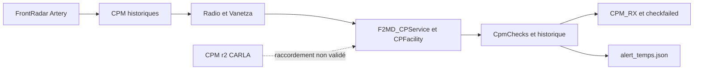
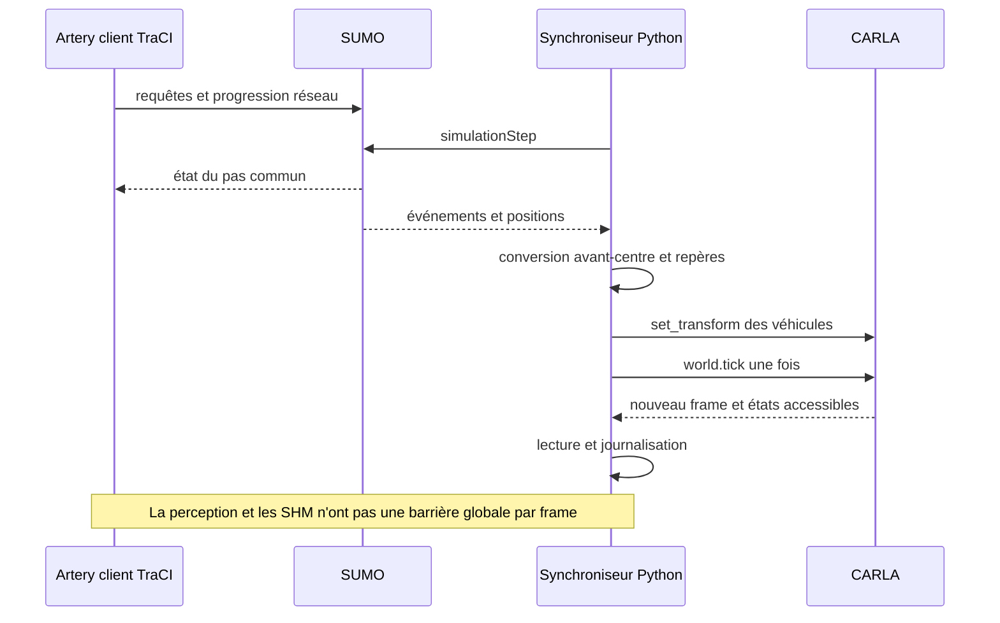
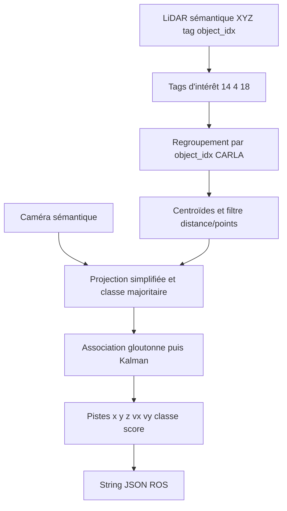
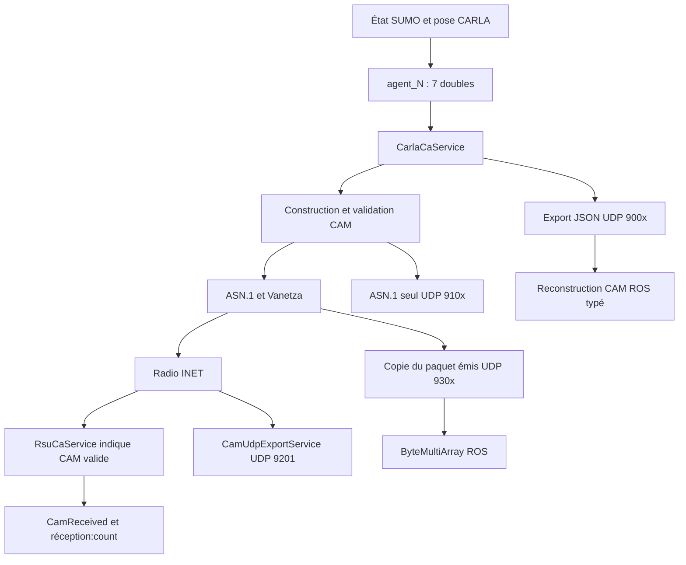
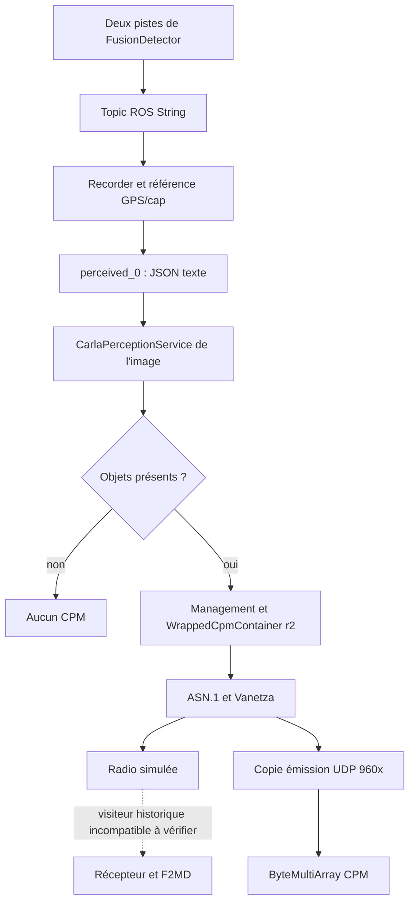
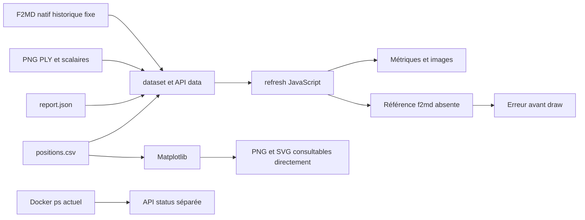

# Rapport d’audit pédagogique, technique et scientifique d’ExFMD-CP

**Audit du 5 novembre 2026 — `D:\ExFMD-CP`.**

Objet : expliquer le projet documenté par Sarra Baati, le code présent et les expérimentations réalisées sur ce PC, en séparant les objectifs, les implémentations et les résultats prouvés.

Version examinée : commit `cb81d13` et état de travail observé au début de l’audit. Aucun code source ni résultat antérieur n’a été corrigé. Aucune simulation n’a été relancée ; aucune image n’a été reconstruite. Les écritures concernent ce rapport et `results/audit-support/`. Un lecteur PDF de 296 ko a été utilisé directement depuis son archive, sans installation dans Python ; aucun composant du projet n’a été réinstallé.

## Convention de lecture

- **Fait vérifié** : observation dans le code, un fichier conservé, un recalcul ou une interrogation en lecture seule.
- **Déduction** : explication soutenue par les faits, sans causalité entièrement établie.
- **Hypothèse** : possibilité qui demande encore des données ou une expérience.
- **Affirmation documentaire** : élément annoncé dans le PFE ou la présentation, non automatiquement reproduit ici.

Une référence `chemin:L42` désigne la ligne 42 de la version examinée, depuis `D:\ExFMD-CP`. Les pages PDF sont comptées depuis la couverture : la page PDF 64 de `main.pdf` porte le numéro imprimé 56. Les pages de présentation sont ses diapositives.

Pièces de traçabilité : [index des modules](audit-support/INDEX_MODULES.md), [inventaire et empreintes](audit-support/inventory.json), [métriques recalculées](audit-support/metrics-recomputed.json), [recalcul F2MD](audit-support/f2md-recomputed.json), [références de lignes](audit-support/line-references.json), [diagnostic du dashboard](audit-support/dashboard-check.json).

## 1. Résumé général du projet

ExFMD-CP cherche à réunir la circulation des véhicules, une scène routière 3D, des capteurs simulés, des communications V2X et la détection de messages trompeurs. Il permet d’étudier ce qu’un véhicule apprend des autres et comment vérifier cette connaissance partagée.

Le rapport PFE est signé **Baati Sarra**, pour l’UPHF/IEMN et SUP’COM, année 2025–2026. Les deux documents ont été lus : **66 pages pour main.pdf, 34 diapositives pour presentation.pdf**. Leurs textes paginés et empreintes sont conservés dans les annexes. Trois pages présentant des incohérences importantes ont également été vérifiées visuellement.

Sur ce PC, une démonstration courte fonctionne : SUMO déplace un à trois véhicules sur Gyrovia ; CARLA applique leurs positions et fournit les capteurs ; FusionDetector transforme les données sémantiques en objets ; Artery génère CAM/CPM et simule une RSU ; ROS reçoit des exports et des données de perception. Les fichiers de résultats sont consultables indépendamment du dashboard.

Cela ne reproduit pas encore scientifiquement tout le PFE. Il manque notamment une chaîne validée CPM Release 2 → F2MD → alerte ROS, le DS7 physique, des essais de portée radio, une validation normative indépendante et une évaluation statistique des attaques.

Principales découvertes de cet audit :

1. Les « 113 CAM décodés ROS » sont en réalité des **CAM typés reconstruits depuis un export JSON de l’émetteur**. Le bridge utilisé ne décode pas leurs octets ASN.1. Les réceptions radio sont prouvées séparément par la RSU.
2. Le maximum de **1,97 µm** est confirmé dans deux runs du 4 novembre. Le run du 5 novembre contient un échantillon à **0,0564725 m, soit 5,65 cm**. Une précision micrométrique générale n’est pas démontrée.
3. F2MD a produit des décisions et des fichiers d’alerte dans un diagnostic natif séparé. Cela ne valide ni sa précision ni son raccordement aux CPM r2 de CARLA.
4. Le dashboard référence un élément HTML `f2md` absent : son actualisation peut échouer avant de dessiner les graphiques, malgré HTTP 200 et une syntaxe JavaScript valide.
5. Le PFE et la présentation n’annoncent pas les mêmes résultats d’attaque. La conclusion du PFE concerne un autre projet. Ces documents doivent être contextualisés.

## 2. Problématique et objectifs

Un système de transport intelligent utilise des capteurs, du calcul et des communications pour mieux connaître la circulation. Une voiture équipée voit son environnement avec ses capteurs. Une voiture connectée reçoit aussi des informations d’autres stations.

Exemple : un camion masque B au véhicule A. Une RSU observe B et avertit A. C’est utile, mais un message peut être retardé, mal géoréférencé, issu d’un capteur imparfait ou volontairement falsifié. Même une signature valide ne prouve pas qu’un obstacle annoncé existe.

Plusieurs simulateurs sont nécessaires parce qu’ils ne représentent pas le même phénomène. SUMO organise les mouvements ; CARLA produit la scène et les mesures ; Artery/OMNeT++ représente les échanges réseau ; F2MD examine les annonces. ROS transporte des données entre applications. Docker fournit les environnements préparés, sans exécuter automatiquement les scénarios.

Le PFE vise une co-simulation cohérente, la perception véhicule et RSU, des CPM Release 2, l’interaction bidirectionnelle avec le DS7, un adaptateur r2 vers le format historique F2MD et des attaques AddObj/DropObj évaluées par TPR, FPR et latence. Voir pages PDF 18–20 et 28–43.

La variante locale vise d’abord une démonstration observable : trois Tesla au maximum, vitesse limitée à 4 m/s, une RSU et 75 pas de 50 ms. Cette réduction est une adaptation expérimentale explicite, pas le scénario original complet.

## 3. Définitions des technologies

| Technologie | Définition et rôle | Entrées | Sorties | Intérêt et conséquence de son absence |
|---|---|---|---|---|
| CARLA | Simulateur client/serveur, scène 3D et capteurs | Carte, acteurs, poses/commandes, paramètres temporels | Images, LiDAR, GNSS/IMU, états | Sans lui, SUMO/Artery peuvent tourner mais sans ces capteurs 3D |
| SUMO | Simulateur microscopique de trafic | Réseau, routes, types de véhicules | Poses, vitesses, événements | Pilote la mobilité du diagnostic ; son absence bloque ce synchroniseur |
| TraCI | API TCP de contrôle de SUMO | Requêtes, abonnements, passage au pas suivant | États et acquittements | Relie les clients Python/Artery au même trafic |
| Artery | Framework de simulation V2X | Mobilité, services ITS, paramètres radio | Paquets, indications et statistiques | Sans lui, un topic ROS ne constitue pas une transmission radio V2X |
| OMNeT++ | Moteur à événements discrets | Réseau NED, INI, bibliothèques | Ordonnancement, logs, scalaires/vecteurs | Exécute les modèles ; sa présence seule ne démarre aucun scénario |
| INET | Bibliothèque de modèles réseau | Positions et émissions | Interférences, décisions de réception | Donne leur signification radio aux statistiques simulées |
| Vanetza | Bibliothèque de protocoles ITS | Messages et requêtes BTP/GeoNetworking | Encodage et paquets ITS | Un JSON ne devient pas automatiquement un paquet normé sans cette chaîne |
| ASN.1 / UPER | Description et encodage compact de structures | Champs et schéma précis | Octets ou structure décodée | Rend possible l’interopérabilité ; réception d’octets ne signifie pas décodage conforme |
| ROS 2 Humble | Middleware de nœuds/topics/messages | Publications, paramètres et callbacks | Livraison aux abonnés, graphe ROS | Découple les ateliers ; sans lui, VehicleAgent ne fonctionne pas |
| DDS / Fast DDS | Découverte et transport derrière le RMW | Données ROS et QoS | Messages aux abonnés compatibles | Domaine/QoS incompatibles peuvent empêcher une réception malgré un topic visible |
| FusionDetector | Détecteur Python à partir de sémantique CARLA et suivi Kalman | LiDAR avec tags/IDs, caméra de classes | Pistes et positions relatives | Perception utilisée ici ; ne requiert pas de réseau neuronal entraîné |
| PointPillars | Famille de détecteurs 3D appris ; ici client TCP seulement | Nuage XYZ/intensité et modèle distant | Détections 3D, scores | Mode IA envisagé ; le serveur/poids ne sont pas exécutés ici |
| F2MD | Framework de contrôles de plausibilité/cohérence | CPM historiques décodés, historique, paramètres | Vérifications, journaux et alertes | Sans entrée compatible, initialiser le module ne prouve aucune détection |
| RSU | Station routière fixe | Position, messages, éventuellement capteurs | CAM/réceptions ; CPM si son service existe | La RSU locale est radio/CAM, pas une caméra fixe ni une RSU CPM complète |
| CAM | Message d’état propre d’une station | Position, cap, vitesse… | Annonce de présence et mouvement | « Voici où je suis » ; ne contient pas la liste des objets perçus |
| CPM | Message de perception collective | Objets observés, informations de référence | Description des objets perçus | « Voici ce que je vois » ; permet la perception coopérative |
| Docker / Compose | Isolation et définition d’environnements | Images, commandes, volumes, réseaux | Processus isolés et ressources partagées | Évite les installations Windows ; `Up` peut simplement signifier `sleep infinity` |
| WSL 2 | Environnement Linux virtualisé | Virtualisation et configuration Windows | Exécution Linux/Docker Desktop | Héberge le moteur, pas le protocole scientifique |
| Dashboard | Serveur Python et interface HTML/JS | CSV, JSON, PNG, PLY, scalaires | Visualisations et liens | Sa panne n’invalide pas automatiquement les fichiers de simulation |

**Temps simulé et temps mural.** Un pas de 50 ms fait avancer le monde de 0,05 s. Le PC peut mettre beaucoup plus de temps à le calculer. La documentation officielle CARLA précise aussi qu’un seul client doit piloter les ticks et que les caméras peuvent livrer des données avec retard : [synchronisation CARLA](https://carla.readthedocs.io/en/0.9.15/adv_synchrony_timestep/). Cette page documentaire concerne 0.9.15 ; les réglages de l’installation 0.9.16 ont été examinés dans son code et ses sorties.

## 4. Architecture globale

### 4.1 Chemin réellement exécuté

```mermaid
flowchart LR
  WIN[PowerShell Windows] --> CMP[Compose ROS et Artery]
  WIN --> CARLA[Serveur CARLA]
  AR[Artery et OMNeT++] -->|lance| SUMO[SUMO 1.19]
  SUMO <-->|TraCI client 1| AR
  SUMO <-->|TraCI client 2| PY[Runner Python dans ROS]
  PY -->|API et ticks| CARLA
  CARLA -->|mesures| VA[VehicleAgent et FusionDetector]
  VA -->|String JSON| REC[Recorder ROS]
  REC --> SHMP[/dev/shm/perceived_0]
  PY -->|7 doubles| SHMS[/dev/shm/agent_N]
  SHMP --> CPM[Service CPM r2]
  SHMS --> CAM[Service CAM]
  CAM --> AR
  CPM --> AR
  AR <-->|radio simulée| RSU[RSU CAM]
  CAM -->|UDP JSON 900x| BR[Bridges ROS]
  AR -->|copies de paquets émis 930x et 960x| BR
  BR --> REC
  REC --> FILES[CSV JSON JSONL PNG PLY scalaires]
  FILES --> DASH[Dashboard]
```

Exemple : A est `hero`. Son état SUMO est appliqué dans CARLA. Ses capteurs observent B et C. Les deux objets passent par ROS et un fichier partagé. C++ construit un CPM r2. Une copie du paquet émis arrive au bridge ROS. Ce compteur n’est pas un compteur de réception radio par B ou C.

### 4.2 Branche F2MD distincte



Dans ce diagnostic, A observe B par le radar simulé d’Artery, pas par le LiDAR CARLA. F2MD prend des décisions sur le format historique. Ce chemin ne prouve pas que les objets de FusionDetector ont traversé le détecteur.

Le PFE ajoute le DS7 physique, un véhicule fantôme, la perception de RSU, un adaptateur r2/r1, un bridge d’alertes et une décision. Un diagramme documentaire ne prouve pas que ces briques sont présentes ou exécutées dans l’environnement local.

## 5. Analyse des dossiers et fichiers

### 5.1 Périmètre et méthode

L’index de cet audit décrit 158 fichiers source/texte hors bibliothèques et sorties expérimentales : chemins, tailles, SHA-256, imports, classes, fonctions, lignes et interfaces. Les dépendances Python/SUMO, XML de réseaux, captures et journaux sont regroupés par nature. Elles ne sont pas présentées comme du code original de Sarra. Les sources du détecteur ont été copiées depuis l’image en lecture seule pour figer la version examinée.

Les binaires FBX et `.so` ne sont pas prétendus intégralement relus comme du code source. Leur présence, rôle et identité sont documentés. La correspondance exacte source C++ → binaire reste une limite faute de manifeste reproductible. Les scripts d’audit lisent les données structurées sans toucher aux sorties antérieures.

Le dossier `spawners/` annoncé dans le README et `perception/bridges/README.md` annoncé par le README principal n’existent pas dans cet état du dépôt.

### 5.2 `artery-services/` : Git et image ne sont pas interchangeables

| Fichiers | Rôle et flux | Fonctions principales | Dépendances et exécution |
|---|---|---|---|
| `CarlaCaService.{cc,h,ned}` | 7 doubles `agent_N` → CAM + export JSON/octet | `initialize`, `trigger`, `readHeroState`, `sendCam`, `indicate` | Artery/Vanetza/ASN.1/POSIX ; service homonyme exécuté depuis l’image |
| `CarlaPerceptionService.{cc,h,ned}` | Git : JSON → CPM historique ; image : JSON `perceived_N` → CPM r2 | `initialize`, `readCarlaObjects`, `buildCpm`, `sendCpm`, `indicate` | Versions différentes ; seule la version compilée de l’image a été exécutée |
| `RsuCaService.{cc,h,ned}` | CAM de la RSU et réception/validation de CAM | `initialize`, `sendCam`, `indicate`, signaux `CamSent`/`CamReceived` | StationaryMiddleware, position fixe, radio ; compteurs `.sca` |

La version Git de `CarlaPerceptionService.cc` construit `asn1::Cpm`, utilise `cpm.cpmParameters` et une expression régulière qui attend notamment `point_count`. La version image utilise `asn1::r2::Cpm` et `WrappedCpmContainer`, lit des champs indépendamment de leur ordre et choisit `perceived_N`. Pour expliquer les 38 paquets r2, il faut lire cette dernière, conservée dans `audit-support/container-sources/artery/CarlaPerceptionService.cc`.

Même dans l’image, `indicate` utilise encore le visiteur historique `asn1::Cpm` (L82), tandis que l’émission utilise `asn1::r2` (L205 et suivantes). L’asymétrie explique une question de compatibilité à examiner ; elle ne fournit pas un convertisseur r2/r1 fonctionnel.

### 5.3 Les entrées `cosimulation/main*.py`

**`main.py`** charge un YAML, initialise ROS, recharge une carte, démarre SUMO Town04, attend `hero/hero1/hero2`, attache un VehicleAgent à chaque véhicule et lance l’exécuteur ROS. Il conserve des chemins `/home/syfra/...` et des `world.tick()` supplémentaires après `sync.tick()`. Aucune preuve n’établit son exécution complète locale.

**`main1.py`** est une variante incomplète qui utilise `world` et `client` sans leur initialisation dans le chemin visible. Ce n’est pas une entrée fiable pour cette installation.

**`main_uphf.py`** conserve le monde chargé et choisit UPHF. Les adaptations rendent les chemins relatifs au script, ajoutent `configs/gyrovia.yaml`, rendent les IDs configurables, suppriment les doubles ticks et corrigent l’intervalle du calcul de vitesse. Ses fonctions sont `load_config` L37, `main` L42 et `cleanup` L77. **La démonstration intégrée enregistrée passe par `scripts/run_integrated_demo.py`, pas par une preuve de lancement de ce main.**

Le YAML utilise `hero_ids: ['0']` parce que les routes fournies ont des IDs numériques. Le diagnostic intégré crée explicitement `hero`, `hero1`, `hero2` : les deux configurations ne doivent pas être confondues.

### 5.4 `carla_multi_agent/`

**`vehicle_agent.py`, classe VehicleAgent L25.** Reçoit un acteur CARLA, un index, le monde et le YAML. Le constructeur crée publishers, queues et timers ; `_attach_sensors` L67 installe RGB, LiDAR brut, GNSS et IMU. `_lidar_callback` L130 transforme le buffer en Nx4 float32 et publie un `PointCloud2` à 16 octets par point. `_run_detection` L156 privilégie FusionDetector et publie une liste JSON dans un `String`. `update_state` L243 alimente statut/odométrie ; les timers utilisent le temps mural. Le statut contient une vitesse en km/h ; le CSV intégré utilise des m/s.

Un seul VehicleAgent est créé pour `hero`, même dans le test à trois véhicules. Les deux autres ont une mobilité et des CAM, mais pas chacun leur suite complète de capteurs ROS. Le runner crée en plus une caméra embarquée, une caméra extérieure et un LiDAR d’export.

Limites : exceptions LiDAR parfois masquées, worker ancien sans travail utile, publication de `vehicle_transform` selon deux conventions de signes, orientation IMU à vérifier, timestamps ROS sans `/clock` partagé. Le nettoyage historique du VehicleAgent ne détruit pas explicitement ses capteurs de fusion ; le runner le fait séparément.

**`fusion_detector.py`** contient KalmanTracker L24 et FusionDetector L75. NumPy, CARLA, verrous et calculs géométriques suffisent ; aucun poids neuronal n’est chargé. Le fonctionnement et ses limites sont détaillés en section 6. Il a réellement produit deux pistes dans les runs à trois véhicules.

**`semantic_detector.py`** est une autre variante sémantique, présente mais non désignée comme le détecteur exécuté dans les preuves conservées.

**`pointpillar_client.py`** propose `PointPillarClient.detect` : nuage Nx4 float32 → taille sur 4 octets → TCP 9999 ; retour longueur puis JSON. Serveur, poids et pipeline d’entraînement ne sont pas fournis dans ce chemin. `recv(4)` n’est pas protégé contre une lecture partielle et aucun timeout socket n’est posé. Une exception devient une liste vide ; elle peut donc être confondue avec une scène sans détection.

**`traffic_manager.py`** encapsule le Traffic Manager et le spawn de NPC selon une configuration. Il ne pilote pas les trois véhicules SUMO du diagnostic. Ses paramètres ne décrivent pas les vitesses mesurées ici.

### 5.5 `sumo-integration/`

Le README cite une base de Bouchouia et collaborateurs, 2022, initialement documentée pour CARLA 0.9.11–0.9.13, SUMO 1.8 et OMNeT++ 5.6.2. C’est une provenance héritée, pas la liste des versions courantes.

| Module/données | Rôle, fonctions et interfaces | État local |
|---|---|---|
| `run_synchronization.py` | SimulationSynchronization, mappings SUMO/CARLA, étapes dans les deux sens | Exécuté |
| `sumo_integration/sumo_simulation.py` | Lance/rejoint TraCI, abonnements, état acteurs, feux/routes | Exécuté ; traci, sumolib, lxml, CARLA |
| `carla_simulation.py` | Spawn/suppression, `set_transform`, tick, feux | Exécuté ; spawn avec physique désactivée |
| `bridge_helper.py` | Repères, référence avant/centre, dimensions, blueprints, feux | Exécuté pour imposer **et comparer** les poses |
| `constants.py` | ID invalide et offset de spawn | Importé |
| `data/vtypes.json`, `carlavtypes.rou.xml` | Correspondances et types | Données auxiliaires |
| `examples/uphf_piste/` | Réseau, routes et sumocfg Gyrovia | Réseau et première route réutilisés |
| `examples/Town01/04/05`, net/rou | Cartes génériques | Non employées dans les preuves Gyrovia |
| `simulation_modules/synchro_client.py` | Ancienne entrée Simulation, attaques, coloration | Présente, non lancée par le runner actuel |
| `carla_artery_connection.py` | ArterySynchronization, serveur TCP 65432, CAM textuels | Ancien transport différent des UDP actuels |
| `attacker_module.py` | Attaques de positions et véhicules fantômes | Non utilisées dans ces runs |
| `detection_module.py` | Detector, contrôle de vitesse SSC, RLDetector avec modèle externe | Ce n’est pas F2MD CPM ; non testé |
| `painting_module.py` | Painter et coloration acteurs/messages/attaques | Non utilisé par le runner |
| `artery/src/.../CaService.cc`, `BasicNodeManager.cc`, `Core.cc` | Patches de l’ancienne intégration | Pas de manifeste prouvant leur présence dans la compilation actuelle |

`uphf_piste/hero.rou.xml` contient un `<additional>` avec rerouter, pas un hero. Les routes principales portent les IDs `0`, `1`, etc. `--ignore-route-errors` facilite le lancement sans constituer une validation exhaustive des routes.

### 5.6 `perception/` : plusieurs générations de bridges

Ces variantes ne doivent pas être lancées ensemble sans architecture explicite : plusieurs contrôlent les ticks et modifient le monde.

| Fichier | Classes/fonctions et flux | Limites et état |
|---|---|---|
| `multi_shm_bridge.py` | AgentBridge, callbacks GNSS/IMU/statut, `write` ; `/vehicle_N/...` → 7 doubles | Statut km/h converti en m/s, timestamp mural ; non utilisé, runner écrit directement |
| `perception_shm_bridge.py` | PerceptionShmBridge.on_perceived ; String → taille little-endian + JSON et fichier absolu | Contrat différent du JSON texte de l’image ; non utilisé |
| `bridges/cam_bridge.py` | CAM réel envisagé, Traffic Manager, cache d’altitude CSV | `/its/cam_received`, chemin absolu et tick propre ; non testé |
| `cam_bridge2.py` | Variante CamBridge avec GPS et tick | Dépend de CARLA/ROS/ETSI ; non testée |
| `cam_bridge22.py` | Ajoute une liste perçue issue de l’API CARLA | SHM `perceived_hero` préfixée ; pas une inférence capteur brute ; non testé |
| `cam_bridge3.py` | Véhicule fantôme, interpolation 20 Hz | `set_transform`, physique activée ; non testé |
| `cam_bridge4.py` | CamBridgeHybrid, conduite hybride | Variante autonome de pilotage/tick ; non testée |
| `cambridge4.py` | Autre fichier, nom sans underscore, TM 8002 | Ne pas le confondre avec `cam_bridge4.py` ; non testé |
| `cam_generator2.py` | CamGeneratorV2, vitesse GNSS et CAM typés à 10 Hz | Entrées `/vehicle2/gnss` et `/vehicle2/imu`, différentes du runner ; non testé |
| `cpm/cpm-generator.py` | MultiCpmGenerator et DetectorAgent, acteurs à moins de 100 m → CPM ROS ETSI | Vérité terrain API, pas FusionDetector ; non exécuté ici |
| `cpm/cpm_bridge.py` | GPS et positions relatives → acteurs perçus CARLA | Risque de confondre objet annoncé et objet véritable ; non exécuté |
| `cpm/simulate_real_cpm.py` | Génération d’un JSON pour tester un bridge | « real » dans le nom ne prouve pas une réception physique ; non exécuté |

Les CPM observés dans le diagnostic ne proviennent pas d’un lancement de `simulate_real_cpm.py` : le chemin exécuté va de FusionDetector au service compilé.

### 5.7 `real-vehicle/` et données DS7

`replay_trajectory.py` lit le CSV via un chemin absolu, retient un point lorsqu’il s’est éloigné de plus d’un mètre et applique les poses toutes les 50 ms. Le commentaire « un point sur cinq » n’est pas le filtre réellement écrit. Le script ne respecte pas les différences de temps d’origine après filtrage et fixe z=0.5. Une trajectoire visuellement correcte ne prouverait pas la fidélité temporelle.

`fake_cam_publisher.py` synthétise des CAM depuis le CSV sur `/its/cam_received` : fournisseur de test, pas un DS7 connecté. `gnss_to_shm.py` souscrit à `/vehicle1/gnss`, etc., calcule vitesse/cap et écrit `agent_N`, avec des namespaces différents du runner. `art_spawn.py` contient son propre VehicleAgent et MultiVehicleSpawner, à distinguer de la classe de co-simulation. `artery_ros_bridge.py` correspond au bridge CAM de l’image ; la copie de cette image est archivée.

Le CSV `uphf_trajectory.csv` contient **75 187 lignes**, un écart de temps de **375,87 s**, environ **200,03 intervalles/s** et une longueur XY de **2 219,96 m**. Cela corrobore son volume et son parcours annoncés. Les 13 fichiers `.trj`, journaux du capteur et rosbags ne sont pas présents pour authentifier l’acquisition initiale. Aucun run intégré analysé ne lit ce CSV.

### 5.8 `real-vehicle/c-its/`

Le paquet `v2x_apps` déclare un auteur/mainteneur **Apostolos Georgiadis**, une licence MIT et notamment rclpy, vanetza_msgs, FastAPI, uvicorn et websockets. Le dépôt agrège donc aussi du code tiers.

| Fichier/groupe | Rôle et entrée/sortie | Lancement ou classe ; état |
|---|---|---|
| `btp_listener.py`, `btp_sender.py` | Écoute BTP et service d’émission | Exécutables ROS homonymes ; non testés ici |
| `cam_listener.py` | Réception CAM ETSI | CamListener ; pas la source des CAM du diagnostic |
| `cam_provider_simulator_centralServer.py` | Normalisation et envoi au serveur central | Store/forwarder/provider ; non exécuté |
| `cam_provider_static_path.py` | CAM depuis trajet statique | Fournisseur de test ; non exécuté |
| `cpm_listener.py` | Lecture d’un CPM ROS ETSI TS et conversion d’unités | Nécessite un CPM décodé, pas des octets ByteMultiArray |
| `cpm_provider.py` | Construction CPM depuis données applicatives/objets | Dépend des interfaces cube ; non testé |
| `cpm_bridge.py` | LidarObjectDetector, nuage → objets/markers | Autre perception, non FusionDetector ; non testée |
| `denm_node.py` | Réception/construction DENM | Dépend aussi de cube_den_msgs ; non testé |
| `vam_provider.py` | Messages d’usagers vulnérables | Non testé |
| `poim_provider.py`, `poim_listener.py`, `poim_listenerV2.py` | Parking, encodage/décodage et BTP | Variantes non testées |
| `ldm_server.py` | LdmStore/WebSocketHub/LdmServer, stations/objets/parking, expiration, HTTP/WS | Autre dashboard, non exécuté |
| `c2c/stationary_vehicle_trigger.py` | Service véhicule stationnaire | F-string multiligne incompatible avec Python 3.8/3.10 ; non testé |
| `central_server.py` | FastAPI, PoimStore/CamStore/WebSocketHub, ingestion et diffusion | `python central_server.py ...`, port documentaire 8010 ; non exécuté |
| `test.py`, `test2.py` | Tests websocket ingestion/consommation | `test2.py:L71` a un `+` orphelin, erreur de syntaxe ; non exécutés |
| `run_cits_stack.sh` | tmux, domain_bridge, devcontainer | Peut installer des outils ; n’a pas été lancé pendant l’audit |
| `fastrtps.xml`, métadonnées, package/setup et ASN.1 | Configuration, dépendances et formats | Ne constituent pas des résultats de communication |

Le frontend `www/` utilise React/Vite, LDMContext, LDMMap, ParkingInfoPanel et ChannelMetricsPage. App/main, composants, styles et configurations ont été indexés. Cette application est distincte du dashboard 8765 ; son build et sa connexion au cube n’ont pas été validés.

### 5.9 Carte, Docker, anciennes visualisations et démos

`map-uphf/` fournit FBX, XODR source/aligné, GeoJSON Lambert-93 selon le README et métadonnées RoadRunner. Les XODR ont chacun **114 éléments road, 137 enregistrements de voies driving, 463 géométries**. Le serveur CARLA expose **183 points de spawn**, vérifiés en lecture seule. Ces objets ne sont pas synonymes. Le PFE indique 104 spawns ; la présentation annonce 938 waypoints et 220 routes de navigation : versions et méthodes de comptage restent à réconcilier.

Dans `docker/`, Dockerfile construit CARLA avec des archives absentes du Git ; launch_uphf.sh lance Epic/offscreen et attend le serveur ; README_tuteur décrit l’usage ; IMAGE_DOWNLOAD contient une adresse à compléter ; compose.runtime orchestre ROS et Artery seulement.

Les trois anciens dashboards sur 8888 sont `map_dashboard.py` (CAM typés), `dash.py` (découverte de CAM) et `art_dash.py` (lecture d’octets CAM). Ils ne sont pas exécutés dans les preuves locales étudiées. Un décodeur manuel ne vaut pas une validation ASN.1 exhaustive.

`demo/demo_gyrovia.py` choisit le premier blueprint véhicule, applique un throttle puis attend en temps mural. `capture_gyrovia.py` attend une image et tient compte du mode synchrone. Leur présence dans le commit d’adaptation ne prouve pas leur auteur initial. `demo/gyrovia_demo.png` ne prouve pas le scénario à trois véhicules.

### 5.10 Scripts, résultats et dépendances

Les 22 fichiers de `scripts/` sont détaillés en section 8. Les sorties regroupent preuves, graphiques dérivés, configurations utilisées et dépendances réutilisables. `runtime-audit/deps/` représente environ 316 Mo ; `plot-deps/` environ 149 Mo ; le wheel CARLA environ 34 Mo. Ce ne sont pas des résultats scientifiques.

Un report.json est une synthèse produite par le programme. Sa valeur augmente lorsque les CSV, messages et scalaires permettent de la vérifier. Les compteurs de callback, traces brutes et graphiques ont des degrés d’indépendance différents, explicités dans les sections 11–12.

## 6. Fonctionnement complet de la simulation

### 6.1 Ordre réel du lancement

L’ordre n’est pas une chaîne strictement séquentielle « percevoir, émettre, recevoir, détecter » répétée de façon parfaitement atomique. Plusieurs callbacks et horloges coexistent.

1. PowerShell démarre les deux services Compose et vérifie le conteneur CARLA existant. Le script principal ne sait pas recréer un conteneur CARLA absent ni démarrer Docker Desktop ; ces actions ont été faites séparément le 5 novembre.
2. CARLA charge la carte Gyrovia depuis son image. Le client Python doit pouvoir appeler `get_world()` et lire la carte avant la suite.
3. Le lanceur ROS vérifie ses dépendances et crée un nouveau dossier `run-<date>`. Le dashboard démarre ou est réutilisé ; il présente encore un ancien résultat tant que le nouveau n’est pas terminé.
4. `run_artery_diagnostic.py` archive et remet à zéro les états partagés appartenant au projet, dérive la première route Gyrovia, crée un à trois véhicules et écrit l’INI/services.
5. `opp_run` charge les bibliothèques et les NED, instancie le monde et la RSU, puis PosixLauncher démarre SUMO avec deux clients.
6. Dans ROS, le runner initialise rclpy, les deux bridges de l’image et Recorder. Des publishers RAW existent déjà, même lorsqu’aucun paquet n’arrive.
7. Le runner se connecte au même SUMO, sur 8813, avec l’ordre client 2. `SimulationSynchronization` met CARLA en mode synchrone de 50 ms.
8. Après le premier pas SUMO, les IDs sont associés à des acteurs CARLA. La physique de ces acteurs est désactivée et leurs poses sont imposées par SUMO.
9. Quand `hero` existe, VehicleAgent et FusionDetector sont créés. Le runner ajoute ses capteurs d’export. Les callbacks de capteurs commencent aux pas suivants.
10. À chaque itération, `sync.tick()` avance SUMO, applique les poses et avance CARLA une seule fois. Le runner lit ensuite les poses, la vitesse SUMO et l’écart par rapport à la pose convertie.
11. Les états de chaque véhicule sont écrits directement sous `agent_N`. Seul l’état de `hero` alimente son VehicleAgent ROS. Les capteurs et timers publient en parallèle.
12. FusionDetector lit les capteurs sémantiques. La publication d’objets est déclenchée par le callback LiDAR brut du VehicleAgent, qui consulte la dernière sortie du détecteur ; il ne s’agit pas d’une barrière garantissant que tous les capteurs ont le même frame ID.
13. Recorder reçoit ce String, enregistre le message et écrit un JSON texte dans `perceived_0`, enrichi de la dernière référence GPS/cap connue.
14. Artery lit les états/objets pendant ses propres événements. CarlaCaService génère les CAM ; CarlaPerceptionService r2 n’émet que si sa liste d’objets n’est pas vide. Les messages passent par Vanetza et le modèle radio, avec des exports UDP distincts.
15. Les bridges ROS reçoivent les JSON ou octets et publient ; Recorder observe les véritables callbacks reçus et les journalise.
16. Après 75 itérations et une attente d’une seconde murale, le runner construit sa synthèse, détruit les capteurs/acteurs de son scénario, ferme TraCI et restaure les paramètres CARLA. Artery finit son horizon de 4 s.
17. Les CSV et JSON sont écrits ; `export_plots.py` relit les sorties et produit PNG/SVG ; le navigateur relit le dossier choisi quand on actualise.
18. **F2MD n’est pas appelé dans ce chemin principal.** Les deux probes constituent des exécutions séparées.

Références centrales : `scripts/run_integrated_demo.py:L61–L91`, `scripts/run_artery_diagnostic.py:L15–L59`. Les plages sont indiquées ici pour localiser un bloc ; les fonctions et points de calcul exacts sont indexés en annexe.

### 6.2 Synchronisation CARLA–SUMO



Exemple : SUMO donne la position de l’avant du véhicule sur son réseau. BridgeHelper retire la demi-longueur, applique `netOffset` et inverse l’axe Y pour obtenir une pose CARLA. Comparer directement les deux coordonnées sans ces transformations produirait une fausse erreur.

Le synchroniseur entretient deux dictionnaires d’identifiants. Les acteurs contrôlés par SUMO vont de `sumo2carla_ids` vers CARLA. L’autre dictionnaire sert aux acteurs d’origine CARLA. Dans le diagnostic étudié, les trois Tesla sont dans le premier cas. Ce n’est pas une expérience où une commande de volant/accélérateur produit leur trajectoire physique.

### 6.3 Perception : ce que fait vraiment FusionDetector



Exemple : A obtient des points portant l’ID de B et le tag véhicule. Le détecteur les regroupe, calcule un centroïde relatif et maintient une piste. Il n’apprend pas à reconnaître B à partir d’une silhouette inconnue : CARLA fournit déjà le tag et l’ID.

Détails vérifiés dans `fusion_detector.py` :

- Tags 14, 4, 18 pour les classes traitées, L11–L20 ; le tag est une convention de cette version CARLA.
- Caméra à x=2 m, z=1,4 m ; LiDAR à z=2,5 m, paramètres issus du YAML. Le PFE décrit d’autres paramètres : il ne faut pas les recopier comme ceux du run.
- Format sémantique de 24 octets par point : XYZ, cosinus d’incidence, ID et tag. Filtre par tag puis groupe par `object_idx` ; appel à `world.get_actor` pour rejeter notamment l’ego.
- Moins de deux points ou distance hors de 0,5–55 m : rejet. Une métadonnée correcte ne garantit donc pas que tout objet soit détecté, surtout s’il est occulté ou hors capteur.
- Projection caméra simplifiée sans compensation explicite complète de l’écart de position entre caméra et LiDAR. Elle ne constitue pas une calibration extrinsèque validée.
- Association par plus petite distance, **gloutonne**, pas algorithme hongrois. Seuil 5 m, maintien limité par `max_misses=3`, `min_hits=1`.
- Filtre Kalman à modèle de vitesse constante avec **dt fixé à 0,1 s**, alors que le couplage avance de 0,05 s. Les vitesses de pistes doivent être revalidées et ne sont pas des mesures absolues de vitesse véhicule démontrées.
- Le score retourné est fixé à 1.0. Ce n’est ni une probabilité ni un score de réseau neuronal calibré.
- La sortie ne contient pas systématiquement dimensions, accélérations ni `point_count`, malgré les descriptions plus larges du PFE.

La fusion image/LiDAR n’est pas une fusion entre véhicules. La perception collective commence lorsque cette liste d’objets est partagée avec d’autres stations.

### 6.4 Génération et réception des CAM



Exemple : A émet son état. La RSU le reçoit au travers du modèle radio et incrémente son signal. En parallèle, un JSON de l’état d’A a déjà été envoyé au bridge ROS. Recevoir ce JSON ne prouve pas que le message radio a atteint la RSU.

Dans le service examiné, la génération est déclenchée par l’intervalle écoulé (`trigger` L51, `sendCam` L79), avec une pause murale `usleep(30000)`. Le code ne met pas en œuvre les seuils de changement de vitesse/cap décrits dans le PFE pour ce service. On ne doit pas conclure à l’application complète des règles dynamiques ETSI.

Le service remplit latitude/longitude en 1e-7 degré, cap en 0,1 degré, vitesse en 0,01 m/s ; il valide le message avant l’encodage. Le runner fixe accélération et yaw rate à zéro dans le SHM : ces champs ne représentent pas des estimations dynamiques vérifiées. L’export JSON 900x est repris par `_publish_cam` du bridge. Les octets RAW 930x et ASN.1 seul 910x sont des branches différentes. L’export 9201 concerne les messages vus par le service promiscuous, mais il n’alimente pas le Recorder actuel.

### 6.5 CPM : de l’observation à l’export brut



Exemple : A annonce B et C dans un CPM. Les 38 enregistrements ROS prouvent que les octets d’émission sont arrivés au bridge. Ils ne prouvent pas que B a décodé ce CPM ni qu’un détecteur a jugé son contenu.

Le builder r2 crée un management container avec temps de référence, GPS de la station et un originating vehicle container ; il ajoute les objets avec position quantifiée en cm, informations cinématiques et classes disponibles. Le code limite à dix objets et attribue de nouveaux IDs 1,2,… à chaque message : le `track_id` de Kalman n’est pas conservé. La valeur `abs(velocity)` devient une composante X et Y est zéro ; dimensions et accélérations absentes prennent des valeurs par défaut ou sont omises. Ces transformations perdent de l’information et doivent être auditées avant un usage scientifique du suivi F2MD.

Le `protocolVersion=2` d’un header ne suffit pas à identifier un CPM Release 2 : le service historique utilise aussi un header numérique de version 2. C’est la structure ASN.1 précise qui distingue les formats. [ETSI TS 103 324 V2.1.1](https://www.etsi.org/deliver/etsi_ts/103300_103399/103324/02.01.01_60/ts_103324v020101p.pdf) décrit le service de perception collective Release 2 ; le [dépôt ASN.1 ETSI](https://forge.etsi.org/rep/ITS/asn1/cpm_ts103324) publie les schémas. Le terme « r1 » de ce projet désigne le format historique utilisé par son F2MD ; il ne faut pas en déduire que toute structure ancienne est une conformité à une édition officielle équivalente de cette TS.

## 7. Architecture Docker et réseau

Les identités immuables des trois images figurent dans `audit-support/images.txt` : CARLA commence par `ed0f3173e89a`, ROS par `dd5e867a47d3`, Artery par `333eddecf31d`. Les tags ne suffisent pas pour une reproduction durable si leurs contenus changent ultérieurement.

| Ressource | Configuration réelle | Fonction |
|---|---|---|
| `exfmd-carla` | Image 0.9.16, serveur séparé, connecté au réseau exfmd-runtime | API CARLA accessible par nom Docker |
| `exfmd-artery` | Image 1.0, `sleep infinity`, réseau exfmd-runtime, IPC shareable, SHM 256 Mo | Conteneur de travail ; la simulation est lancée par docker exec |
| `exfmd-ros` | Image 1.0, source Humble puis sleep, network_mode et ipc de service:artery | Partage localhost et `/dev/shm` avec Artery |
| Montage | Dépôt parent monté sous `/repo` dans les deux conteneurs | Configurations et résultats persistants sur D: |
| ROS | ROS_DOMAIN_ID=42 ; rmw_fastrtps_cpp | Découverte et transport DDS dans l’environnement partagé |
| 2000–2002 TCP | Publication du conteneur CARLA vers Windows | RPC/streaming CARLA |
| 8000 TCP | Traffic Manager CARLA | Distinct de la radio et des ports BTP |
| 8813 TCP local | SUMO, deux clients TraCI | Coordination mobilité/réseau |
| UDP 9001–9003 | JSON CAM | Reconstruction CAM typés ROS |
| UDP 9101–9103 | ASN.1 CAM seul | Export non consommé par le Recorder actuel |
| UDP 9201 | CAM vu par CamUdpExportService | Autre branche, non comptée comme CAM JSON du runner |
| UDP 9301 et suivants | Copies RAW GeoNet/BTP/CAM | Emplacements attribués par ordre de création |
| UDP 9601 et suivants | Copies RAW GeoNet/BTP/CPM | Décalage de 300 par rapport au slot CAM |
| Ports BTP 2001 et 2009 | Champs à l’intérieur des paquets ITS | CAM et CPM ; ne sont pas les ports UDP Windows |
| 8765 TCP Windows, 127.0.0.1 | Serveur des résultats | HTTP local, distinct de ROS |

Partager un réseau Docker ne suffit pas pour faire de `127.0.0.1` l’adresse d’un autre conteneur. Ici, les deux services partagent réellement le même espace réseau, ce qui rend cohérents les UDP C++ codés en dur. CARLA reste un autre hôte logique : le client emploie `exfmd-carla`, pas localhost.

Le SHM des états est **7 doubles natifs, 56 octets** : latitude, longitude, cap, vitesse, accélération, yaw rate, timestamp. Le runner utilise degrés, degrés, degrés, m/s, m/s², rad/s et temps CARLA. D’autres bridges stockent un temps Unix mural : le contrat temporel n’est pas unifié. La perception de la variante est un JSON texte. Certains scripts historiques utilisent au contraire quatre octets de longueur + JSON. Le PFE p.35 généralise à tort ce dernier protocole aux trois flux.

Les écritures `write_bytes/write_text` ouvrent et tronquent les fichiers ; les lecteurs peuvent accéder au même moment sans version, verrou interprocessus ou double buffer. Une lecture partielle est donc un risque technique concret. `/dev/shm` réduit les accès au disque mais n’annule ni sérialisation JSON, ni copies, ni latence.

L’image Artery fournit OMNeT++ **5.6.2**, observé dans les logs, et un SUMO système **1.12**. Le diagnostic utilise le SUMO **1.19** conservé dans results. Le README principal annonçant 5.7.1 ne décrit pas la version exécutée. Le stockage Docker observé est sur D:, conformément à la contrainte ; aucune migration de stockage n’a été faite pendant cet audit.

## 8. Explication des scripts d’exécution

| Script | Fonction et données produites | Limite ou condition |
|---|---|---|
| `start-exfmd.ps1` | Compose, CARLA existant, réseau, garde de processus, préparation, dossier unique, Artery puis ROS, export des graphiques | Ne démarre pas Docker Desktop ; ne recrée pas CARLA absent ; attente fixe 3 s pour Artery, pas de vrai healthcheck |
| `run_artery_diagnostic.py` | Archive SHM, extrait route, écrit vType et INI, RSU et services, lance opp_run | Variante déclarée ; types et paramètres simplifiés, pas scénario original intégral |
| `run_ros_demo.sh` | Source Humble, définit PYTHONPATH/SUMO_HOME et lance le Python | Dépend des bibliothèques conservées sous results |
| `prepare_ros.sh` | Vérifie CARLA Python ; installe le wheel conservé dans /tmp si absent | Réutilise l’archive locale, dépend d’un interpréteur compatible |
| `run_integrated_demo.py` | Synchronisation, capteurs, Recorder, SHM, CSV/JSON/JSONL, captures | Constantes 75 pas et chemins spécifiques à /repo ; un seul agent capteur |
| `start-dashboard.ps1` | Test HTTP, serveur Python caché si besoin, ouverture navigateur | Un HTTP 200 ne vérifie pas le JavaScript ni l’identité exacte d’un serveur déjà présent |
| `results_server.py` | Lecture des résultats et état Docker | Sélection lexicographique, pas une garantie de run scientifiquement valide |
| `export_plots.py` | Relit tous les CSV intégrés et PLY, écrit PNG/SVG | Réécrit aussi les anciens graphiques à chaque lancement ; les SVG peuvent changer même sans données nouvelles |
| `status-exfmd.ps1` | Liste conteneurs, appelle API et cherche le runner | Un processus présent n’est pas la preuve d’un message reçu |
| `stop-exfmd.ps1`, `stop_integrated.py` | Signaux ciblés, puis arrêt ROS/Artery ; dashboard optionnel | CARLA conservé ; fenêtres de nettoyage bornées ; pas d’arrêt global Docker |
| `start-gyrovia.ps1`, `validate_gyrovia.py` | Test CARLA physique court, résultats horodatés | 1–50 pas ; conduite tout droit non adaptée à un long parcours |
| `start-cosimulation.ps1`, `validate_cosimulation.py` | Ancien test borné CARLA–SUMO seul | Suppose les dépendances et le serveur présents |
| `setup-sumo.ps1` | Préparation isolée de SUMO/NumPy/YAML/lxml | Pas une commande d’audit ; non relancée ici |
| `stop-gyrovia.ps1`, `stop_validation.py` | Arrêt des anciens processus de validation | Ne couvre pas le runner intégré, qui a son propre arrêt |
| `audit_artery.py`, `test_artery_adapted.py` | Tentatives historiques de chargement original/adapté | Leurs noms ne signifient pas que ces scénarios sont passés |
| `probe_f2md.py` | Récepteur F2MD historique et état réel figé, 1 s, pas de CARLA couplé | Reçoit les types r2 sans preuve de traitement compatible |
| `probe_f2md_native.py` | FrontRadar et CPM historiques, 3 s autonomes | Ne valide pas l’adaptateur r2 ni le scénario d’attaque du PFE |

Les probes copient les états actuellement présents sous `/dev/shm` dans le dossier de résultats ; ils ne restaurent pas automatiquement les états archivés de demo-003. Leur entrée de mobilité est dérivée de demo-003 mais un relancement dépendrait aussi des états partagés au moment du lancement. Cette dépendance implicite réduit leur reproductibilité.

L’exporteur de graphiques explique les SVG modifiés dans Git après une relance : cela ne signifie pas que quelqu’un a modifié les positions originales. Il faudrait séparer des figures déterministes et datées pour une conservation scientifique stricte.

## 9. Description des scénarios

| Scénario | Mobilité | Perception et communication | Preuve et portée |
|---|---|---|---|
| Démo initiale | Throttle, temps mural | Capture ponctuelle | Immobilité initiale rapportée, logs complets absents |
| CARLA physique long | Tesla, 120 pas | RGB/LiDAR/GNSS/IMU | Déplacement puis sortie de piste et chute ; test échoué |
| CARLA physique court | Tesla, 50 pas de 50 ms | Même suite, sans V2X | Déplacement 5,79 m et faible variation verticale |
| SUMO seul | Réseau UPHF existant, 10 s | FCD et résumé | Deux véhicules insérés ; pas de radio ni capteurs 3D |
| CARLA–SUMO seul | 60 pas, route fournie | Pas ROS/V2X | Une association et déplacement 9,76 m |
| Intégré un véhicule + RSU | 75 pas, jusqu’à 4 m/s | Agent capteur, CAM, pas de CPM si aucun objet | 38 CAM typés observés ; RSU reçoit 38 et émet 39 |
| Intégré trois véhicules + RSU | Même route décalée, départs 3/10/17 m | Un hero capteur, trois stations CAM, deux pistes, CPM r2 | 225 positions ; trois runs conservés pour comparaison |
| Probe compatible | Artery/SUMO autonome, états figés | CPM r2 émis et un F2MD historique | Aucun enregistrement utile/alerte F2MD |
| Probe natif F2MD | FrontRadar Artery et route Gyrovia, 3 s | CPM historiques, trois services de détection | 114 réceptions et décisions, sans CARLA vivant |

Les scénarios PFE DS7 réel, RSU productrice de CPM, portée à plus d’un kilomètre, AddObj/DropObj avec vérité terrain et adaptation r2/r1 ne sont pas confondus avec ces diagnostics.

## 10. Historique des modifications

L’origine Git locale est `https://github.com/hadil-karous/UPHF-PROJET.git`, et upstream `https://github.com/sarra-ba/exfmd-cp.git`. L’ouverture web du premier n’a pas abouti pendant l’audit ; l’analyse de provenance repose sur le Git local, pas sur une comparaison supposée du dernier état distant.

| Commit | Date et auteur déclarés | Contenu vérifiable |
|---|---|---|
| `b5a9c0c` | 14 juin 2026, sarra-ba | Base initiale du framework |
| `d44d130` | 14 juin 2026, sarra-ba | Carte UPHF, XODR/FBX/GeoJSON |
| `f76e624` | 14 juin 2026, sarra-ba | Services Artery et stack C-ITS |
| `cb81d13` | 4 novembre 2026 19:58 +01:00, hadil-karous | Adaptations locales, scripts, configurations, résultats et dépendances |

L’auteur d’un commit n’est pas nécessairement l’auteur de toutes les lignes qu’il introduit. Les échanges de cette session montrent la création de lanceurs et corrections assistées ; Git seul ne permet pas d’attribuer chaque modification à Codex ou à une personne. Les auteurs tiers cités dans le code doivent rester visibles.

Les différences f76e624 → HEAD montrent surtout des ajouts sous scripts, results, demo, les README d’exécution et Compose. Dans les sources historiques de co-simulation, le changement ciblé porte sur `main_uphf.py` : chemins relatifs, YAML, IDs, suppression du tick double et intervalle de vitesse. Les anciennes variantes sont conservées.

Pourquoi le double tick était un défaut : `sync.tick()` appelle déjà `CarlaSimulation.tick()` et donc `world.tick()`. Appeler ensuite un deuxième tick CARLA fait avancer ce monde deux fois pour un pas SUMO. La correction enlève le second appel ; elle ne garantit pas à elle seule une cohérence des capteurs et des horloges ROS.

Les difficultés Artery réellement conservées sont : mauvais root de package NED, chemins `/home/syfra`, répertoire SUMO de résultats absent, paramètre datetime non assigné à `node0` parce que la configuration utilisait `node[*]`, références à `route2` sans définition et ligne INI concaténée. Le diagnostic corrige ses propres chemins et utilise `node*`, sans réécrire l’image originale.

La relance du 5 novembre a dû démarrer Docker Desktop et recréer le conteneur CARLA disparu depuis l’image locale. Les données de simulation antérieures ont été conservées. Le script principal ne réalise pas encore automatiquement ces deux réparations.

Au début de cet audit, les modifications non committées concernaient le pointeur current-run, le PID du serveur, des SVG régénérés et le nouveau dossier du 5 novembre. Elles ne sont pas annulées. Aucune commande de commit, push, reset ou nettoyage n’a été effectuée pendant l’audit.

## 11. Explications des expérimentations

### 11.1 Expérience 1 — CARLA seul

L’immobilité initiale est rapportée dans la session, mais aucun journal exhaustif ne permet de prouver sa cause unique. Le script initial choisissait le premier blueprint disponible et attendait en temps mural, sans maîtriser le temps simulé. Le test corrigé choisit une Tesla, active explicitement la physique, relâche le frein à main, impose 50 ms et mesure les poses. Cela valide une solution de diagnostic ; cela ne prouve pas que le blueprint initial ou un frein ait été la cause.

Le parcours `scenario2-carla/20261104-183231` contient 120 échantillons. Son déplacement horizontal de 23,70 m et sa vitesse maximale de 24,94 m/s ne sont pas une réussite routière : la voiture sort de la piste et chute, avec une variation verticale maximale de **30,74 m**. Le report a été marqué `movement_pass: false` et le diagnostic conservé.

Le parcours court `20261104-183524` contient 50 échantillons. Son déplacement de **5,792931867 m** est calculé entre la position initiale conservée avant la boucle et la dernière position CSV. La vitesse maximale est **5,114449822 m/s**, à partir de la norme du vecteur vitesse CARLA. La variation verticale maximale est **0,004056168 m**. Les compteurs indiquent 12 callbacks RGB, 25 LiDAR et 50 GNSS/IMU. Une image et un PLY existent ; tous les échantillons caméra ne sont pas sauvegardés.

Le véhicule commence à accélérer après environ 0,8 s simulée dans le CSV. Entre la première et la dernière ligne, il s’écoule 2,45 s ; 50 pas représentent nominalement 2,5 s. Le temps mural de 40,512 s comprend la préparation, les capteurs et l’attente. Le facteur 2,45/40,512 = 0,06048 est une mesure de ce test, pas un benchmark pur du moteur.

### 11.2 Expérience 2 — CARLA et SUMO

SUMO seul a été exécuté dix secondes sur le réseau UPHF : `scenario2-sumo/fcd.xml`, `summary.xml` et `run.log` indiquent deux véhicules insérés. L’outil SUMO était isolé et versionné 1.19.

Le test couplé `scenario2-cosimulation/` contient 60 lignes pour l’ID SUMO `0`, associé à un acteur CARLA. La distance entre premier et dernier XY vaut **9,755368397 m**, arrondie à 9,76 m. La vitesse maximale fournie par SUMO est 6,316893511 m/s. Le temps mural est 42,096 s. Soixante pas de 50 ms correspondent à trois secondes nominales.

La preuve est la répétition de positions CARLA sous un mapping SUMO/CARLA et l’usage effectif du synchroniseur. Ce CSV ne contient pas une deuxième trajectoire SUMO brute permettant de recalculer indépendamment l’erreur de chaque pose. Il prouve un couplage fonctionnel court ; il ne fournit pas encore un audit géométrique indépendant de toute la carte.

### 11.3 Expérience 3 — un véhicule et une RSU

`integrated/demo-001` est un échec à conserver : Artery attendait `World.node0.middleware.datetime` non assigné, puis SUMO a fermé la connexion. Le report indique FatalTraCIError et zéro position. Un conteneur actif à ce moment n’aurait pas constitué une réussite.

`integrated/demo-002` contient 75 poses pour hero, de SUMO t=0,05 à 3,75 s. Le déplacement est **8,539544496 m**, avec une vitesse maximale de 3,992618421 m/s. Aucun autre véhicule n’est perçu, donc aucun CPM n’est émis : c’est le comportement explicite du service r2 lorsqu’`objects` est vide.

Les JSONL contiennent 38 CAM typés de station 88. Les compteurs radio indiquent 38 CAM reçus par la RSU et 39 émis par elle. Ce sont deux preuves distinctes : les 38 messages ROS passent par l’export JSON de l’émetteur ; les 38 réceptions de RSU passent par sa fonction de réception radio/validation CAM.

Un petit défaut de journalisation est visible : demo-002 possède 1 361 lignes `vehicle_status` dans le JSONL, contre 1 359 dans la synthèse actuellement conservée. La copie superficielle des dictionnaires de compteur et la poursuite des callbacks pendant le nettoyage sont des explications compatibles avec cette différence, sans causalité instrumentée. Les compteurs doivent être figés après arrêt de la collecte pour une mesure rigoureuse.

### 11.4 Expérience 4 — trois véhicules et une RSU

Les configurations dérivent de la même première route UPHF, avec départs à 3, 10 et 17 m, vType Tesla, minGap 2 m et maxSpeed 4 m/s. Trois véhicules ont 75 lignes chacun : 225 positions ne signifient ni 225 pas ni 225 véhicules. Un seul hero possède le pipeline de perception.

| Mesure recalculée | demo-003, 4 novembre | run-20261104-193341 | run-20261105-151425 |
|---|---:|---:|---:|
| Véhicules distincts | 3 | 3 | 3 |
| Pas et frames CARLA distincts | 75 | 75 | 75 |
| Lignes de positions | 225 | 225 | 225 |
| Déplacement hero, m | 4,718836628 | 4,718836628 | 4,718836628 |
| Vitesse maximale, m/s | 3,999959666 | 3,999959666 | 3,999959666 |
| CAM ROS typés, recomptage JSONL | 113 | 113 | **115** |
| CPM RAW ROS | 38 | 38 | 38 |
| CAM radio reçus par RSU | 116 | 116 | 116 |
| CAM émis par RSU | 39 | 39 | 39 |
| Dernières pistes FusionDetector | 2 | 2 | 2 |
| Écart spatial maximal, m | 0,00000196605 | 0,00000196605 | **0,0564725064** |
| Temps mural reporté, s | 86,689 | 83,412 | 90,436 |

Les positions finales et les vitesses nominales se reproduisent bien sur ces trois essais, mais pas tous les compteurs d’observation ni le maximum d’erreur. La découverte dynamique des abonnements CAM et les variations d’exécution sont des facteurs à instrumenter, pas une justification pour masquer les différences.

Dans le dernier CSV, **hero1 au pas 26**, frame CARLA 316, SUMO t=1,35 s, garde le XY du pas 25 : x=-3,2929534912 et y=-5,7596054077. Les runs précédents donnent au pas 26 x=-3,3092880249, y=-5,8136639595. Au pas 27, les trajectoires se rejoignent. Le défaut est donc un échantillon resté à la position précédente. Un retard de lecture/cache ou un défaut d’application/observation au même frame est une hypothèse forte ; les données actuelles ne départagent pas ces mécanismes.

Il serait incorrect de supprimer cet échantillon après coup pour conserver l’annonce de 1,97 µm. Il faut conserver le maximum constaté, publier éventuellement des quantiles et instrumenter le frame réellement observé.

### 11.5 Expérience 5 — F2MD : version et origine

Le détecteur exécuté appartient à l’image `sarra13ba/exfmd-artery:1.0`, dont le digest figure dans l’annexe. Le header `F2MD_CPFacility.cc` déclare un auteur Jiahao ZHANG, une date 09/11/2022 et une version de fichier 2.0. Cela n’identifie pas un commit officiel complet du framework. Les sources sont manifestement adaptées : gestion d’exceptions, validations/rapports désactivés et paramètres codés en dur. Il ne faut pas le présenter comme un F2MD amont intact.

**Probe compatible.** `results/f2md-probe/` est autonome Artery/SUMO, avec les derniers états CARLA figés dans les fichiers partagés. CarlaPerceptionService émet du r2, un récepteur F2MD historique s’initialise, mais ses JSON CPM_RX/TX ne contiennent pas d’enregistrements utiles et aucune alerte n’apparaît. Cela montre une initialisation, pas un traitement fonctionnel r2.

**Probe natif.** `results/f2md-native-probe/` active FrontRadar et les services historiques F2MD pour trois véhicules pendant trois secondes. Les CPM sont générés par le pipeline radar d’Artery/SUMO, pas par un LiDAR CARLA actif et pas par la lecture d’un corpus CPM préenregistré. Les fichiers `logjson_cpm_rx*.json` sont des sorties du test. Les CAM utilisent les états partagés précédents, ce qui ajoute une dépendance au contexte du run.

Le recomptage donne **114 enregistrements CPM_RX utiles**, **76 décisions checkfailed>0**, et **38 fichiers alert_*.json**. Les listes JSON comportent un objet `{}` terminal ; il est exclu du comptage. Les fichiers TX restent vides malgré les émissions visibles dans probe.log : absence d’enregistrement TX ne signifie pas absence d’émission.

#### 11.5.1 « Genuine » ne garantit pas trois stations honnêtes

Le chemin `output/GENUINE/.../Genuine` est construit par le service et par le nom du type d’attaque ; il ne constitue pas une vérité terrain. `F2MD_CPService.cc:L625` impose **CP_LOCAL_ATTACKER_PROB=0.3**, malgré le défaut NED de 0.00. L631 impose START_CPM_ATTACK=1.0, malgré le défaut NED de 10 s. Le journal contient effectivement deux `Node mbType=Genuine` et un **`Node mbType=LocalAttacker prob=0.3`**.

En revanche, le type d’attaque CP_LOCAL_ATTACK_TYPE reste le défaut 0, nommé Genuine ; aucune injection AddObj/DropObj n’est prouvée dans ce test. On ne peut ni affirmer « aucun rôle attaquant » ni transformer ce test en évaluation contrôlée d’attaque. Les anciens résumés trop simples doivent être remplacés par cette lecture des paramètres effectifs.

#### 11.5.2 Pourquoi les alertes peuvent apparaître

Le chemin de calcul est réel : `F2MD_CPService::indicate` → `F2MD_CPFacility::onCPM` → `CpmChecks::CpmChecksum` → `checkReception`. Les contrôles couvrent distance, vitesse, cohérence temporelle/position et filtres de Kalman. Si un contrôle échoue, le retour final vaut 1 ; le service journalise checkfailed et écrit un fichier d’alerte.

Une incohérence majeure est lisible dans la version copiée :

- La construction de `sensorInformationContainer` est désactivée par **`if(false)`** dans F2MD_CPService.cc, autour de L540.
- CpmChecksum passe un conteneur capteur vide de substitution lorsque ce champ manque.
- `distancePlausibility` initialise CheckResult à faux, parcourt zéro zone de perception et retourne **`!CheckResult`**, donc 1.

**Déduction forte :** un CPM ayant des objets mais aucune information de zone capteur est rejeté par ce contrôle, indépendamment d’une attaque réelle. Les logs montrent des CPM avec POC=1 et d’autres avec POC absent ; cette structure est compatible avec 76 décisions positives sur 114. Les sorties ne contiennent toutefois pas le détail de chaque bit de contrôle, donc l’attribution exhaustive de chaque alerte à cette seule cause reste à instrumenter.

Autre défaut précis : dans CpmChecks.cc, le delta en secondes est stocké dans un `long` après division par 1000. Un écart de 100 ms devient 0 seconde. Les tests de variation de vitesse/position peuvent alors employer un intervalle nul. S’ajoutent des conversions d’unités et conventions de repères à valider. Aucune correction n’a été faite pendant cet audit.

#### 11.5.3 Alertes, événements et qualité du détecteur

Le nom `alert_<instant_ms>.json` n’inclut pas le récepteur. Deux stations peuvent écrire au même instant et remplacer le même fichier ; 76 décisions positives peuvent laisser 38 fichiers. Les fichiers d’alerte ne conservent que checkfailed=1.0 et simtime, sans station ni objet ni raison.

Le ratio 76/114=66,7 % est un **taux de signalement observé**, pas un TPR. Un TPR exige des attaques injectées et étiquetées. L’appeler FPR scientifique supposerait d’avoir établi que chaque message est honnête, valide et correctement interprété. Au vu des défauts de format, paramètres et contrôles, les alertes sont suspectes de faux positifs ou d’incohérences internes, mais elles ne peuvent être individuellement classées avec les seules données conservées.

La génération de rapports détaillés vers une autorité est elle-même désactivée par `if (false && checkfailed...)` dans CPFacility L220. Aucun bridge d’alerte ni abonnement `/v2x_alert` n’est exécuté par le runner intégré.

```mermaid
flowchart TD
  RX[CPM historique reçu] --> VIS[Visiteur ASN.1 historique]
  VIS --> FAC[CPFacility.onCPM]
  FAC --> CHECK[CpmChecksum]
  CHECK --> DIST[Distance et informations capteur]
  CHECK --> HIST[Historique et cohérence temporelle]
  DIST --> FLAG[checkfailed booléen]
  HIST --> FLAG
  FLAG --> JSON[CPM_RX]
  FLAG --> FILE[alert_instant.json sans récepteur]
  FILE -. bridge absent .-> ROS[/v2x_alert]
```

Exemple : A annonce correctement B, mais omet la description de sa zone capteur. Le contrôle de distance de cette version peut rejeter B. L’alerte existe techniquement, mais on n’a pas démontré qu’A mentait.

## 12. Analyse détaillée des résultats et unités

### 12.1 Origine de chaque métrique centrale

| Valeur | Fichier source et calcul exact | Signification et limite |
|---|---|---|
| 75 pas | `integrated/demo-003/positions.csv`, nombre distinct de `step` ; runner L64 `range(75)` | Pas de mobilité, pas des secondes murales |
| 225 positions | Nombre de lignes CSV hors en-tête = 75×3 | Trois observations par pas ; 225 n’est pas la longueur d’une trajectoire |
| 4,718836628 m hero | Dernier/premier XY de hero, hypot(dx,dy) ; runner L91 | Déplacement net, pas somme des distances |
| 3,999959666 m/s | Maximum de `speed_m_s`, lui-même `traci.vehicle.getSpeed` | Maximum sur tous les véhicules, pas exclusivement hero |
| 113 CAM le 4 novembre | JSONL, topics `/its/cam/v88` 37, v161 38, v234 38 | Messages typés reconstruits depuis JSON d’émission, pas décodages ASN.1 indépendants |
| 115 CAM le 5 novembre | Même recomptage : 37, 39 et 39 | Compteur d’observation non strictement reproductible |
| 38 CPM RAW | JSONL, `/simulator/vehicle2/cpm` | Réception UDP/ROS d’une copie de paquet émis |
| 116 CAM RSU reçus | `omnet-results/General-#0.sca:L1003`, reception:count | Émissions des trois stations effectivement validées par la RSU simulée |
| 39 CAM RSU émis | Même `.sca:L1001`, transmission:count | Signal de génération RSU, distinct des messages reçus |
| Deux pistes | report fusion_objects + dernières listes JSON du topic de perception | Détections sémantiques suivies ; pas deux sorties d’un modèle IA appris |
| 1,966049922e-6 m | Maximum de la colonne `sync_position_error_m` dans demo-003 et run du 4 novembre | Autocohérence d’une pose appliquée ; pas précision GPS/radio/carte |
| 0,0564725064 m | Maximum de la même colonne le 5 novembre, hero1/pas26 | Écart ponctuel confirmé ; empêche une généralisation du maximum micrométrique |
| 114 réceptions F2MD | Objets CPM_RX avec sourceId, trois fichiers natifs | 38 records utiles par récepteur, pas les `{}` terminaux |
| 76 signalements | Records précédents avec checkfailed>0 | Décisions techniques, sans vérité terrain d’attaque validée |
| 38 fichiers d’alerte | Nombre de fichiers alert_*.json natifs | Nombre de chemins distincts, affecté par collisions de noms |

Les lignes `.sca` 1001/1003 sont identiques dans les trois runs à trois véhicules examinés ; demo-002 utilise L520/L522. Les empreintes et résultats de recomptage sont dans `audit-support/metrics-recomputed.json`.

### 12.2 Formules et exemples

Déplacement net : `D = sqrt((x_fin-x_debut)^2 + (y_fin-y_debut)^2)`.

Longueur parcourue : `L = somme sqrt((x_i-x_(i-1))^2 + (y_i-y_(i-1))^2)`.

Pour hero, les deux sont presque identiques car le segment est droit. Pour hero2, la longueur vaut **8,31558 m**, contre un déplacement net de **7,87645 m**, car il tourne. Il faut choisir la métrique selon la question posée.

Erreur enregistrée : `e = distance3D(position_CARLA_lue, BridgeHelper(position_SUMO, dimensions))`. Le même helper et les mêmes données sont utilisés pour imposer et évaluer la pose ; l’expérience mesure d’abord la cohérence de cette copie, pas une exactitude par rapport à un relevé indépendant. Le CSV ne conserve pas la pose SUMO brute et la pose de référence calculée : l’audit peut recomputer le maximum des erreurs conservées, mais pas reconstruire indépendamment chaque erreur depuis ces seuls CSV.

Fréquence affichée : `f = (N-1)/(t_dernier-t_premier)` avec `time.monotonic()` mural. Dans demo-003, les CAM typés sont autour de **0,49 Hz muraux** et le CPM autour de **0,483 Hz**, alors que les services sont cadencés dans le temps simulé. Cela ne prouve pas que le mécanisme radio n’émet qu’à 0,49 Hz simulé.

Les 75 pas vont de 0,05 à 3,75 s SUMO : durée entre échantillons extrêmes 3,70 s, durée nominale des pas 3,75 s ; l’horizon OMNeT++ est 4 s. Ces nombres ne sont pas contradictoires, mais leurs définitions doivent être conservées.

### 12.3 Vérification des octets et des compteurs

Les chaînes hexadécimales ont été reconverties en octets. Dans demo-003, les paquets CAM RAW observés font 70 octets pour le slot RSU et 85 pour les slots véhicules ; les CPM font 138 octets. La valeur à l’offset BTP utilisé par PacketCapture vaut 2001 pour CAM et 2009 pour CPM. Cela renforce l’identification du flux, sans constituer un décodage indépendant de toute la charge ASN.1.

Les compteurs JSONL et report concordent pour les topics journalisés de demo-003 et des deux runs suivants. Les images/PointCloud2 ne sont pas enregistrés intégralement dans le JSONL : Recorder conserve leurs compteurs et dernière taille, puis retourne. Leurs nombres de callbacks ne peuvent donc pas être vérifiés en comptant des lignes de messages image. Les PNG/PLY prouvent des acquisitions réelles, mais pas toutes les trames annoncées.

Les logs et images ne portent pas tous un identifiant commun de frame/temps. Une corrélation rigoureuse « cette image → cet objet → ce CPM → cette alerte » n’est pas disponible.

Il est invalide de calculer un PDR en divisant 113 CAM ROS par 116 réceptions RSU : ces compteurs sont issus de branches et d’observateurs différents. Il manque un dénominateur d’émissions adressées à un récepteur donné, un intervalle identique et des IDs de paquets appariés.

## 13. Fonctionnement complet du dashboard

### 13.1 Serveur et choix du résultat

Le serveur est `scripts/results_server.py` ; il écoute uniquement `127.0.0.1:8765` et sert le dossier results. `start-dashboard.ps1` le lance avec Python Windows en arrière-plan et conserve des logs/PID. L’URL est http://127.0.0.1:8765/dashboard/.

`dataset()` trie les sous-dossiers de integrated **par nom décroissant**. Il prend le premier possédant report.json et un CSV non vide. Il ne vérifie pas l’absence d’erreur dans le report ni un statut de validation scientifique. Il n’utilise pas `current-run.txt`. Si aucun dossier ne convient, il utilise la capture CARLA du 4 novembre comme fallback. Les noms horodatés usuels fonctionnent, mais un dossier nommé autrement ou un run échoué partiel peut fausser ce choix.

Le service `/api/data` renvoie le report, les CSV normalisés, le nuage PLY, les chemins images, les scalaires contenant reception/transmission:count et un résultat F2MD pris **toujours dans f2md-native-probe/report.json**. Un nouveau probe horodaté ne devient pas automatiquement le F2MD affiché. Un JSON partiellement écrit ou invalide peut faire échouer la réponse ; il n’y a pas de manifeste atomique « run prêt ».

`/api/status` exécute `docker ps -a --format ...`, filtre les trois noms exfmd et date la requête. Il ne lit ni le débit ROS ni un état de synchronisation. La séparation entre état actuel des conteneurs et mesures historiques est conceptuellement correcte.

### 13.2 Correspondance entre les panneaux et les fichiers

| Élément visible | Origine et calcul | Limite |
|---|---|---|
| Vue extérieure | overview.png du dossier choisi, ou gyrovia_hero.png en fallback | Image ponctuelle, pas caméra temps réel |
| Caméra embarquée | onboard.png, première image conservée par callback | Pas une vidéo, pas toutes les trames ROS |
| Nombre d’échantillons | Longueur du CSV renvoyé | Ne représente pas le nombre de véhicules ni de pas |
| Déplacement | report.displacement_m | Hero seul et distance nette ; mauvais intitulé si on l’interprète pour toute la flotte |
| Vitesse maximale | report.max_speed_m_s | Maximum de tous les véhicules, indépendamment du véhicule sélectionné |
| Écart maximal | report.max_sync_position_error_m | Maximum global ; pas erreur cartographique |
| Trajectoire | CSV filtré par sumo_id, X et **-Y**, dessin canvas | Échelles indépendantes sur X/Y : la géométrie peut être déformée visuellement |
| Vitesse | speed_m_s par indice de ligne du véhicule | Axe X = échantillon, pas seconde ; le PNG Matplotlib utilise le temps SUMO |
| Relecture | Curseur, boucle JS toutes les 100 ms | Animation d’archives à vitesse arbitraire, pas simulation recalculée |
| LiDAR | PLY ASCII lu après end_header, au plus 20 000 points | Rotation autour de Z et projection 2D simplifiée ; échelles choisies pour le dessin |
| Synchronisation | Courbe des erreurs par échantillon du véhicule choisi | Référence issue du même helper ; pas de mesure de latence |
| CAM/CPM | report.topic_counts | Réceptions de callbacks ROS, pas toutes des réceptions radio ; fréquence murale |
| Nœuds | report.ros_nodes | Liste historique au moment du test, pas découverte en direct |
| RSU | Lignes scalar filtrées dans les .sca | Le filtre est général et ne vérifie pas formellement le type de service |
| FusionDetector | report.fusion_objects | Dernière liste, pas historique complet de toutes les pistes |
| F2MD | JSON du probe natif fixe | Diagnostic séparé, pas résultat du run CARLA sélectionné |
| Conteneurs | Requête Docker au moment du clic | Processus sleep possible, aucun débit de messages vérifié |
| Graphiques exportés | measurements.png/svg et lidar.png | Fichiers dérivés pouvant être réécrits par l’exporteur |

Le PLY conserve XYZ et intensité ; le dessin JS ne prend que XYZ. Le bouton d’actualisation rappelle fetch pour les deux API ; il ne relance pas CARLA. Les images n’ont pas de mécanisme spécifique d’invalidation de cache, mais les nouveaux dossiers ont de nouvelles URL.

### 13.3 Défaut bloquant confirmé

`results/dashboard/index.html:L22` contient `$('f2md').textContent = ...`, mais aucun élément de la page ne possède `id="f2md"`. La section contient `id="fusion"` et une note statique ancienne, pas cet identifiant.

Conséquence : `getElementById` retourne null ; l’affectation provoque « Cannot set properties of null (setting 'textContent') ». Le catch remplace le libellé de run par « Erreur de lecture ». Cette instruction précède l’affichage FusionDetector, les liens et les appels `draw()`/`drawLidar()`. Le premier affichage des graphiques est donc interrompu. Certains panneaux précédents, notamment images/tableau, peuvent déjà avoir été remplis.

Un contrôle statique des IDs et une exécution isolée du vrai script avec un DOM simplifié ont reproduit l’erreur : `audit-support/dashboard-check.json` indique missingDomIds=[f2md], erreur correspondante et **zéro appel au contexte canvas**. Ce contrôle n’est pas présenté comme un test dans un navigateur complet. Il établit la faute de référence et le chemin d’interruption ; HTTP 200 et `node --check` n’auraient pas suffi à la trouver.

Le texte HTML contient aussi des caractères mal réencodés, des `?` à la place d’accents et des indications statiques F2MD dépassées. Le serveur ne déclare pas explicitement le charset de son JSON ; les navigateurs appliquent normalement le comportement JSON UTF-8, mais d’autres clients peuvent mal l’afficher.

**État d’audit : dashboard partiellement validé, avec défaut d’affichage identifié.** Aucun correctif n’a été appliqué, conformément à la demande de ne pas modifier le code. Les PNG/SVG exportés restent des moyens indépendants de voir les résultats.



Exemple : cliquer Actualiser ne remet pas les véhicules en mouvement. Le serveur choisit une archive, le navigateur relit ses mesures et anime éventuellement ses positions. Si la référence DOM échoue, le fichier measurements.png conserve tout de même ses courbes.

## 14. Comparaison avec le rapport original de Sarra

### 14.1 Ce que les documents annoncent et ce qui est localement prouvé

| Sujet | PFE / présentation | Code ou preuve locale | Conclusion d’audit |
|---|---|---|---|
| Co-simulation | Cohérence de plusieurs simulateurs et radios | Runs courts, mappings, CSV et scalaires | Intégration technique partielle démontrée ; pas toute l’étude originale |
| Perception sémantique | Détecteur de référence « parfait », dimensions et suivi | Tags/IDs privilégiés, centroïdes, Kalman ; dimensions pas systématiquement produites | Référence contrôlée mais pas réellement omnisciente ni sans erreur géométrique |
| Association | Pipeline décrit avec Kalman + hongrois | Association gloutonne par distance | Différence d’algorithme concrète |
| Capteurs | Exemple 64 canaux, 200 000 points/s, positions décrites au PFE | YAML 16 canaux, 16 000 points/s ; caméra z=1,4 m | Configuration locale allégée, pas reproduction des paramètres |
| Mode IA | PointPillars/OpenPCDet et détecteur d’images | Client TCP seulement, pas de serveur exécuté ni de poids évalués | Résultats IA non reproduits |
| CAM | Seuils dynamiques et export UDP reçu | Intervalle temporel dans CarlaCaService ; ROS depuis JSON d’émission | Ne pas revendiquer la même règle ni le même observateur |
| SHM | Taille 4 octets + JSON généralisée | État 7 doubles ; perception JSON texte ; autres variantes préfixées | Contrats réellement différents |
| Direction du pont | PFE p.35 décrit CARLA→SUMO, moveToXY | Variante exécutée principalement SUMO→CARLA | Les deux architectures existent conceptuellement mais ce n’est pas le même scénario |
| CPM de RSU | RsuPerceptionService et capteurs RSU | RSU CAM seulement ; source/class recherchée non retrouvée | Fonction non reproduite dans les images examinées |
| r2 vers r1 | Adaptateur déclaré développé, PFE p.41 | Générateur r2, visiteurs historiques, probe sans réception utile | Aucun chemin d’adaptation fonctionnel identifié et validé |
| DS7 | CAM/CPM sur cube physique, Wireshark et ghost | CSV et stack présents, aucune liaison physique testée sur ce PC | Données disponibles, interopérabilité physique non reproduite |
| Déploiement | Image ROS annoncée avec alert bridge et decision node | Image observée : artery_ros_bridge.py, cpm_os_bidge.py et map_dashboard.py | Contenu réel plus réduit que le texte documentaire |
| Alertes | F2MD → v2x_alert_bridge → decision_node | Fichiers séparés, pas ces nœuds/topics exécutés | Boucle d’alerte intégrée absente des preuves |
| Temps réel | Présentation évoque une latence <50 ms | Environ 80–90 s murales pour le test intégré de quelques secondes simulées | Latence physique ou temps réel non reproduits |

### 14.2 PointPillars : résultats documentaires et prudence

Le PFE p.60–61 décrit des scores inférieurs au seuil 0,5, puis un fine-tuning sur 431 exemples CARLA pendant 30 époques, une loss de 3,9e-10 et aucune détection sur de nouvelles scènes. La présentation p.18 indique un score maximal inférieur à 0,35. Ce sont des affirmations documentaires, pas des calculs reproduits ici : les checkpoints, logs complets d’entraînement, partitions et exemples ne sont pas présents dans le chemin exécuté.

Un écart de domaine est une explication plausible : distribution du nuage, intensités, montage du capteur, classes, boîte de référence, filtrage, densité et prétraitement diffèrent entre KITTI et CARLA. Une loss très basse ne prouve pas à elle seule une mémorisation : il faudrait aussi écarter une fuite de données, une erreur d’annotations, de convention ou d’inférence. Le constat documentaire d’échec en généralisation mérite d’être investigué, pas transformé en preuve d’un benchmark local.

### 14.3 Contradiction des résultats d’attaques

La page PDF 64, tableau 4.6 « valeurs préliminaires », indique :

| Attaque | CPM malveillants annoncés | Alertes correctes | TPR | FPR | Latence moyenne |
|---|---:|---:|---:|---:|---:|
| AddObj | 30 | 7 | 23,3 % | 8,5 % | 12 ms |
| DropObj | 30 | 3 | 10,0 % | 5,2 % | 15 ms |

La diapositive 28 montre au contraire **22 détectés / 8 manqués** pour AddObj et **19 détectés / 11 manqués** pour DropObj, soit 73,3 % et 63,3 % si les 30 événements sont le dénominateur. Elle annonce également N=2 420 messages et latence <15 ms. Le rôle exact de N et son lien avec les trente attaques ne sont pas explicités par les données disponibles.

Ces différences ont été confirmées visuellement dans `audit-support/verification-1.png` et `verification-3.png`, pas seulement par extraction textuelle. On ne peut ni fusionner les chiffres ni choisir silencieusement ceux qui paraissent les meilleurs. Il faut les logs bruts, les versions des scénarios et une clarification de l’autrice concernant les séries expérimentales. Aucune de ces deux séries n’a été reproduite par le probe natif à 114 réceptions.

### 14.4 Autres incohérences documentaires

- La page PDF 66, conclusion imprimée 58, décrit une **station météo STM32/ThingSpeak/Edge AI**, pas ExFMD-CP. Vérification visuelle : `verification-2.png`. C’est une incohérence éditoriale du document fourni ; elle ne permet pas d’inférer l’intention de son autrice.
- Certaines figures sont remplacées par un nom de fichier, par exemple `figures/docker_compose.png` ou `figures/portee_courbe.png`. Des références bibliographiques restent affichées `[?]`. Le document paraît donc contenir des éléments non finalisés.
- Le tableau de portée radio p.51 donne des rapports reçus/attendus supérieurs à 1, par exemple 1,379. Ils ne peuvent pas être interprétés comme un PDR probabiliste avec un nombre exact d’émissions au dénominateur ; ils reflètent une estimation/calibration d’un débit attendu, que le texte reconnaît partiellement.
- Le texte du test de contrôle parle de 2 contre 4 m/s ; le tableau associé affiche 4 contre 8 m/s. Il donne des coupures 1060 et 1200 m tout en concluant qu’elles sont au même endroit. Ces éléments ne suffisent pas à valider une portée précise et reproductible.
- Les nombres de spawns/segments/waypoints des documents et du code ne sont pas uniformes ; il faut fournir la version de carte et la méthode de comptage.

Ces constats ne disqualifient pas toutes les réalisations du projet. Ils imposent de traiter les documents comme des descriptions et résultats déclarés à réconcilier avec les sources et expériences, plutôt que comme une référence expérimentale infaillible.

## 15. Limites techniques

### 15.1 Déploiement et reproductibilité

Le lanceur principal suppose Docker Desktop opérationnel et le conteneur CARLA existant. Le délai fixe de trois secondes n’est pas un healthcheck Artery/SUMO. Plusieurs opérations Docker ne sont pas suivies d’une validation fonctionnelle détaillée. Une erreur avant le bloc try du runner peut laisser des nœuds ou un marqueur running ; une erreur pendant un nettoyage peut masquer l’erreur initiale.

Les dépendances sont conservées sous results au lieu d’un environnement décrit séparément ; cela facilite la relance sur ce PC mais mélange logiciel et données. Les images sont identifiables par digest, mais il manque un manifeste de compilation reliant précisément chaque source aux `.so` exécutés. Une restauration des images ne restaure pas automatiquement tous les fichiers temporaires de conteneur.

### 15.2 Réseau et données

La dépendance à localhost impose un réseau partagé. Les slots RAW sont attribués par ordre de création, RSU incluse : le nom ROS vehicle2 ne désigne pas toujours la deuxième voiture. Les bridges fournis n’écoutent que trois slots, alors que RSU + trois véhicules créent quatre interfaces ; la dernière copie RAW est perdue pour cet observateur. Les exports JSON des trois véhicules restent disponibles.

La mémoire partagée n’a pas de protocole de lecture atomique/versionnée ni de contrôle systématique de fraîcheur. Plusieurs formats portant des noms proches sont incompatibles. L’absence de valeurs réelles d’accélération/yaw rate dans le runner peut être prise à tort pour une mesure de zéro.

### 15.3 Perception et frames

Les callbacks sémantiques, LiDAR brut, RGB et référence GPS ne sont pas associés par frame commun. La projection n’applique pas toute la géométrie extrinsèque. L’intervalle Kalman 0,1 s ne correspond pas au pas de 0,05 s. La création d’un thread de détection par callback est sans contrôle explicite de charge. Les IDs d’objets CPM sont recréés et les vecteurs de vitesse sont simplifiés.

L’écart spatial ponctuel du 5 novembre montre qu’il faut lire l’état correspondant au frame effectivement attendu, journaliser aussi la pose de référence et vérifier la validité de chaque observation.

### 15.4 Rendu et performances

L’avertissement lavapipe a été observé au démarrage. Il suggère un chemin Vulkan logiciel possible ; la visibilité du GPU dans Docker ne prouve pas que CARLA le sélectionne pour ce rendu. Les essais sont lents. Il n’existe pas ici de profil GPU/CPU complet, de capture d’utilisation Vulkan ou de mesure isolée d’inférence : attribuer tout le ralentissement à un seul composant serait spéculatif.

### 15.5 Sources F2MD réellement adaptées

Le code hardcode la probabilité d’attaquant et le début d’attaque, désactive des rapports et certaines validations, supprime l’information capteur émise, et peut perdre la fraction de seconde dans delta_Time. Les défauts précis sont plus utiles à corriger qu’une conclusion générale « le détecteur n’est pas bon ». Les traces ne contiennent pas encore tous les diagnostics permettant de mesurer séparément l’effet de chaque défaut.

### 15.6 Interface et conservation des preuves

Le défaut DOM `f2md`, les caractères corrompus, les métriques globales mélangées au véhicule sélectionné, le choix lexicographique et le F2MD fixe rendent l’interface partiellement trompeuse ou incomplète. L’exporteur réécrit les graphiques historiques ; les SVG modifiés dans Git en sont une conséquence. Les CSV/JSONL originaux doivent rester la référence prioritaire.

## 16. Limites scientifiques

### 16.1 Validité du construit

Chaque métrique doit mesurer la propriété annoncée. Un écart entre pose imposée et pose lue mesure la copie d’état ; il ne mesure pas le géoréférencement absolu. Un compteur JSON ROS mesure la branche JSON ; il ne mesure pas la propagation radio. Une alerte mesure une décision du programme ; elle ne mesure pas directement un comportement malveillant.

La perception sémantique constitue un instrument de référence privilégié. Elle donne accès à des informations que n’aurait pas un capteur réel, tout en restant affectée par visibilité, densité, projection et suivi. Son score 1.0 n’établit ni une précision statistique de 100 % ni une supériorité d’algorithme IA.

### 16.2 Validité interne

L’étiquette Genuine ne décrit pas toute la configuration effective. Les paramètres hardcodés, le défaut de zone capteur et les erreurs temporelles sont des facteurs de confusion. Les journaux d’alerte doivent identifier émetteur, récepteur, objet, cause et temps, faute de quoi on ne peut construire une matrice de confusion fiable.

Les sources copiées et logs sont compatibles avec l’explication du contrôle de distance, mais seule une instrumentation des bits et une comparaison contrôlée avant/après permettraient d’établir une causalité exhaustive. Cette expérience n’a pas été faite dans l’audit, conformément à sa lecture seule.

### 16.3 Validité externe

Trois véhicules, quelques secondes, une route et une RSU proche ne représentent pas un trafic dense, des occlusions complexes, une grande diversité d’usagers ni un canal réel. Il n’y a pas de validation de nuit, pluie, trafic important, coalitions d’attaquants ou généralisation de modèles sur des scènes inédites.

Le CSV DS7 ne prouve pas la présence du véhicule physique pendant les runs. Les résultats d’interopérabilité matérielle décrits dans le PFE nécessitent leurs captures réseau, identités de matériel, paramètres radio et journaux temporels. Ils ne sont pas transposés à ce PC par la seule possession du code.

### 16.4 Robustesse statistique et reproductibilité

Il existe plusieurs répétitions courtes, mais pas un plan multi-seeds avec intervalles de confiance ni une série d’attaques étiquetées. Les 113/115 CAM montrent une sensibilité de l’observateur ; l’écart de 5,65 cm montre la sensibilité de lecture. Il faut publier les répétitions, distributions d’erreur et conditions d’exclusion avant de donner une précision générale.

Pour une évaluation F2MD, définir l’unité de décision : message, objet, station ou attaque. TPR=TP/(TP+FN), FPR=FP/(FP+TN), précision=TP/(TP+FP). Les dénominateurs ne sont pas interchangeables. La latence doit relier un instant d’injection et une décision identifiée sur une même base de temps. Les délais muraux, temps OMNeT++, générationDeltaTime et temps ROS actuels ne suffisent pas à reconstruire cette latence bout en bout.

## 17. Avancement réel et preuves

Aucun pourcentage global n’est calculé : une démonstration visuelle, une interopérabilité physique et une validation scientifique sont des objectifs différents.

| Fonctionnalité | Objectif original | Implémentation présente | Exécutée | Testée | Résultat / classement | Limitation | Preuve |
|---|---|---|---|---|---|---|---|
| Carte Gyrovia CARLA | Scène commune géoréférencée | Image et carte active | Oui | Lecture/captures | Validé pour chargement et vue | Précision absolue non établie | PNG, nom carte, 183 spawns lus |
| Conduite physique courte | Mouvement réel simulé | validate_gyrovia | Oui | 50 pas | Validé sur court segment | Pas parcours autonome complet | scenario2-carla/20261104-183524 |
| Conduite physique longue | Navigation stable | Throttle droit | Oui | 120 pas | Bloqué / test échoué | Sortie de piste et chute | report movement_pass=false |
| SUMO seul | Mobilité routière | Réseau/rou/sumocfg | Oui | 10 s | Validé fonctionnellement | Pas toutes les routes | FCD, summary, run.log |
| Couplage SUMO→CARLA | Cohérence mobilité | SimulationSynchronization | Oui | Répétitions courtes | Partiellement validé | Pose imposée, pas mesure indépendante | CSV couplés |
| Synchronisation micrométrique générale | Cohérence géométrique | Calcul d’écart local | Oui | Trois runs | Impossible à affirmer | Pic 5,65 cm le 5 novembre | ligne hero1/pas26 |
| RGB/LiDAR/GNSS/IMU | Acquisition virtuelle | VehicleAgent et capteurs | Oui | Callbacks et fichiers | Validé pour acquisition | Pas toutes trames persistées | PNG/PLY, compteurs et topics |
| FusionDetector | Référence sémantique | Code exécuté | Oui | Deux cibles | Partiellement validé | Métadonnées, géométrie/temps simplifiés | JSON perception, report |
| PointPillars | Perception brute apprise | Client seulement | Non dans les runs | Non | Implémenté partiellement / bloqué | Serveur, poids et protocole validé manquants | pointpillar_client.py |
| CAM typés ROS | Données d’état ITS | Export JSON et reconstruction | Oui | Recompte 113/115 | Validé comme publication typée | Pas décodage ASN.1 ni réception radio | JSONL /its/cam/v* |
| CAM radio RSU | V2I | RsuCaService et INET | Oui | 116 RX / 39 TX | Validé en simulation courte | Pas radio physique | scalaires .sca |
| CPM r2 émission | Perception collective | Service image r2 | Oui | Logs et octets | Partiellement validé | Validation normative indépendante absente | 38 paquets de 138 octets, BTP 2009 |
| CPM réception ROS brute | Transport d’exports | Bridge UDP RAW | Oui | Recompte | Validé pour le transport d’octets | Ne décode pas le CPM | JSONL /simulator/vehicle2/cpm |
| Décodage CPM r2 complet | Interopérabilité | Schémas et émetteur présents | Pas prouvé ici | Non indépendant | Impossible à vérifier complètement | Manque décodeur/proof round-trip | Branche historique incompatible |
| RSU productrice de CPM | Perception infrastructure | Décrite dans PFE | Non | Non | Absente du chemin disponible | Service recherché non retrouvé | recherche sources/classes |
| F2MD natif | Contrôles plausibilité/cohérence | Service adapté et radar | Oui | 114 RX, 76 décisions | Partiellement validé techniquement | Champs/delta/paramètres, pas qualité | f2md-native-probe |
| Qualité F2MD | TPR/FPR/latence | Pas de protocole local complet | Non | Non | Bloqué | Vérité terrain et instrumentation | absence de série étiquetée |
| Adaptateur r2→historique | Relier CARLA et F2MD | Annoncé par PFE | Non prouvé | Probe négatif | Bloqué | Aucun chemin fonctionnel trouvé | f2md-probe et visiteurs |
| Alertes ROS /v2x_alert | Décision coopérative | Pas de bridge exécuté | Non | Non | Absent du chemin | Fichiers seuls | graphe ROS et imports runner |
| AddObj/DropObj contrôlés | Évaluation de sécurité | Attaques historiques présentes | Pas dans les runs principaux | Non selon protocole PFE | Implémenté mais non testé ici | Paramètres/étiquettes/version à préciser | mdAttacks et documents contradictoires |
| DS7 réel | Boucle matériel/simulation | CSV et stack C-ITS | Non | Non | Implémenté partiellement, non testé | Matériel/captures non disponibles | real-vehicle et aucun run associé |
| Portée radio | PDR selon distance | Modèles présents | Pas dans ces runs | Non | Non reproduit | Manque collecte distances/émissions | seulement affirmations PFE |
| Dashboard historique | Lecture centralisée | Serveur et page | Oui | HTTP, API, JS isolé | Partiellement validé | Null DOM f2md avant graphiques | dashboard-check.json |
| Graphiques exportés | Voir et interpréter | Matplotlib PNG/SVG | Oui | Fichiers inspectés | Validé pour les données tracées | Réécriture des exports | measurements.png/svg |
| Relance/arrêt | Reproductibilité opérationnelle | Scripts PowerShell | Oui | Cycle stop/start réussi | Partiellement validé | Docker/CARLA absents non auto-réparés | logs et run horodaté |

## 18. Fonctionnalités restant à développer

1. Un contrat partagé de coordonnées, unités, temps et identité d’objets, commun à CARLA, ROS, SUMO, CPM et F2MD.
2. Un enregistrement complet par frame : pose brute SUMO, pose cible, pose CARLA observée, temps de mesure et temps de publication.
3. Une acquisition multi-capteurs alignée et un suivi dont dt vient du temps simulé ; calibration caméra/LiDAR et tests d’occlusion.
4. Un builder CPM qui conserve track_id et les composantes/dimensions disponibles, avec tests de bornes et unités.
5. Un décodeur indépendant r2 et un adaptateur vers F2MD, ou un détecteur traitant nativement la Release 2.
6. La correction/paramétrisation des contrôles F2MD, sans paramètres codés en dur ni conteneurs capteurs silencieusement supprimés.
7. Des alertes enrichies et des noms de fichiers uniques, puis un bridge ROS et une décision explicitement validés.
8. Des scénarios d’attaque avec manifeste de vérité terrain et répétitions multi-seeds.
9. Une vraie perception RSU productrice de CPM, identifiée et testée séparément de RsuCaService.
10. Une relance avec healthchecks et reprise après absence de Docker/CARLA ; observabilité propre des tâches et nettoyage en erreur.
11. Un dashboard corrigé, avec sélection explicite de run, état archivage/direct, provenance de chaque métrique et liens réellement disponibles.
12. Une validation sur le DS7 physique, distincte du replay de son CSV.

## 19. Prochaines étapes proposées

**Étape 1 — fiabiliser la lecture, sans nouvelle campagne.** Corriger sur une branche dédiée l’élément DOM absent et l’encodage, identifier les métriques globales/hero, afficher le dernier run valide via manifeste et relier séparément le dernier probe F2MD. Critère : contrôle navigateur complet et tous les liens, y compris scènes sans objet. Aucun correctif n’a été appliqué par le présent audit.

**Étape 2 — figer les preuves.** Archiver digests, commit, INI, YAML, version des sources compilées, graines, liste des processus et schémas. Ne plus réécrire les graphiques antérieurs à chaque lancement. Critère : un dossier de run autonome et un recalcul documenté identique.

**Étape 3 — valider la synchronisation.** Conserver les poses de référence et frames, comparer après acquittement, diagnostiquer le pas 26 sans l’exclure arbitrairement. Critère : distribution d’écarts sur répétitions et traitement explicite des observations périmées ; précision annoncée avec son domaine, pas seulement le meilleur maximum.

**Étape 4 — assainir F2MD natif.** Rendre la probabilité et le début d’attaque réellement paramétrables, rétablir une politique cohérente d’information capteur, corriger le temps fractionnaire et journaliser chaque contrôle. Commencer par un scénario sans attaque prouvé, puis une attaque simple, avant de parler de TPR. Critère : toutes les décisions appariées à une vérité terrain.

**Étape 5 — raccorder le r2.** Capturer/décoder un CPM réel du pipeline, préserver les identités et les unités, ajouter une adaptation traçable ou un traitement natif r2, puis tester une entrée et une alerte connues. Critère : même identifiant suivi de la mesure jusqu’à la décision.

**Étape 6 — élargir la recherche.** Ajouter diversité de scènes, occlusions, bruit, plusieurs graines, trafic plus important et essais hardware. Pour PointPillars, utiliser une vraie séparation entraînement/validation/test par scènes et vérifier les prétraitements avant un nouveau fine-tuning. Pour la radio, mesurer émissions/réceptions appariées et varier les paramètres plutôt que reprendre une portée documentaire.

## 20. Glossaire des termes techniques

| Terme | Explication pédagogique et usage dans ce projet |
|---|---|
| Acteur CARLA | Objet du monde simulé : véhicule, piéton, capteur ou autre entité. Son ID CARLA n’est pas son ID SUMO ni sa station ITS. |
| AddObj | Ajout d’un objet inexistant dans une annonce de perception. Pour l’évaluer, il faut conserver la vérité terrain de l’injection. |
| ASN.1 | Langage décrivant la structure des messages ; il ne transporte pas lui-même le message. |
| BTP | Couche de transport ITS qui distingue les services par des ports logiques, ici notamment 2001 et 2009. |
| CAM | Annonce de l’état de la station elle-même. Analogie : une carte de présence avec position et mouvement. |
| Callback | Fonction appelée lorsqu’une donnée arrive ou qu’un timer expire. Son exécution peut être décalée par rapport au temps de mesure. |
| C-ITS | Systèmes de transport intelligents coopératifs : les stations échangent des informations pour enrichir leur connaissance. |
| CPM | Annonce d’objets perçus par une station. Analogie : un compte rendu de ce que le voisin voit. |
| DDS | Mécanisme de découverte et transport utilisé derrière la couche ROS choisie ici. |
| Digest Docker | Empreinte du contenu d’une image, plus précise qu’un tag susceptible de désigner un autre contenu à l’avenir. |
| Domain gap | Décalage entre les données d’apprentissage et celles rencontrées en utilisation : capteurs, intensités, densité ou scènes différentes. |
| DropObj | Omission d’un objet normalement annoncé ; difficile à distinguer d’une non-détection légitime sans contexte. |
| Ego / hero | Véhicule de référence auquel sont attachés les capteurs et autour duquel on interprète les objets. |
| Faux positif | Alerte sur un cas réellement honnête. Un dossier nommé Genuine ne suffit pas pour établir cette vérité terrain. |
| Frame | Identifiant d’un état ou d’une image du simulateur ; ce n’est pas un temps mural ni un numéro de paquet. |
| FPR | FP/(FP+TN), proportion de cas honnêtes signalés à tort, avec une unité d’évaluation clairement définie. |
| GeoNetworking | Mécanismes réseau ITS employés par Vanetza pour transporter les messages. |
| Géoréférencement | Association entre coordonnées locales et coordonnées géographiques ; distinct de la copie exacte d’une pose entre simulateurs. |
| Ghost / véhicule fantôme | Acteur virtuel représentant un véhicule réel ou une annonce. Sa présence dans CARLA ne prouve pas qu’un véhicule physique soit connecté. |
| Ground truth / vérité terrain | État de référence indépendant utilisé pour dire ce qui existe, quelle attaque est active et quelle décision serait correcte. |
| ID d’objet | Identifiant à maintenir pour suivre le même objet ; recréer 1,2,… à chaque CPM peut casser la continuité de suivi. |
| INI | Fichier de paramètres OMNeT++ ; ses règles de sélection doivent correspondre aux noms réels des modules. |
| ITS-G5 | Technologie de communication véhiculaire employée dans l’architecture Artery étudiée ; sa simulation n’est pas une émission matérielle depuis le PC. |
| JSON / JSONL | JSON représente une structure ; JSONL en conserve une par ligne, pratique pour compter les messages et leur provenance. |
| Kalman | Filtre estimant un état et son évolution ; son pas de temps et ses hypothèses doivent correspondre aux mesures. |
| LiDAR brut | Nuage de coordonnées et intensité, qui ne fournit pas directement les identités d’objets. |
| LiDAR sémantique | Nuage enrichi de classes et d’IDs par le simulateur ; information privilégiée pour une référence expérimentale. |
| Lock-step | Progression coordonnée des simulateurs par pas ; cela ne garantit pas automatiquement l’alignement de tous les callbacks capteurs. |
| NED | Langage définissant les modules et connexions OMNeT++ ; les racines de packages doivent être correctes. |
| PDR | Paquets reçus / paquets effectivement émis pour un même récepteur et intervalle, avec une méthode d’appariement cohérente. |
| PLY | Format de nuage/maillage ; les fichiers CARLA examinés sont ASCII avec coordonnées et intensité. |
| Point cloud | Ensemble de points mesurés par un capteur ; un point n’est pas une détection d’objet. |
| QoS | Paramètres de qualité de service ROS/DDS : compatibilité, fiabilité et conservation des messages. |
| RAW | Octets exportés sans conversion en une structure métier décodée ; RAW ne signifie pas nécessairement données du capteur. |
| RMW | Couche ROS abstraisant le middleware ; rmw_fastrtps_cpp sélectionne l’implémentation employée ici. |
| RSU | Station routière fixe. Dans le diagnostic, elle échange des CAM ; elle n’exécute pas une perception CPM de l’infrastructure. |
| SHM | Mémoire partagée sous /dev/shm. Plusieurs processus voient les mêmes fichiers, mais doivent s’accorder sur format et synchronisation. |
| Station ID | Identité ITS portée par un message, distincte des noms de slots UDP et des identifiants des acteurs. |
| Tick | Demande de passage à l’état simulé suivant. Un second tick involontaire déséquilibre le couplage. |
| Temps mural | Temps réellement écoulé sur le PC ; utilisé pour les fréquences de réception du Recorder. |
| Temps simulé | Horloge du monde calculé ; peut avancer bien plus lentement que le temps mural. |
| Topic | Canal ROS typé. Sa présence dans le graphe ne prouve pas qu’un abonné ait reçu une donnée utile. |
| TPR | TP/(TP+FN), proportion d’attaques réellement détectées parmi les attaques étiquetées. |
| TraCI | Interface TCP de pilotage de SUMO ; permet aux clients de lire les véhicules et de coordonner les pas. |
| UPER | Encodage binaire ASN.1 non aligné. Le schéma exact et les unités sont nécessaires au décodage. |
| V2I / V2V / V2X | Véhicule–infrastructure, véhicule–véhicule et ensemble des interactions avec d’autres stations. |
| WGS84 | Référence géographique des latitudes et longitudes ; pas le repère XY en mètres de CARLA. |

## 21. Annexe des commandes de relance

**Ces commandes sont documentées pour une utilisation ultérieure. Elles n’ont pas été exécutées pour cet audit.** Le rapport ne constitue pas une demande de relancer maintenant la simulation.

Depuis PowerShell dans le dépôt :

```powershell
cd D:\ExFMD-CP

# Afficher les archives déjà disponibles, sans simuler à nouveau :
powershell -ExecutionPolicy Bypass -File .\scripts\start-dashboard.ps1 -Open

# État des conteneurs et présence du runner :
powershell -ExecutionPolicy Bypass -File .\scripts\status-exfmd.ps1

# Scénario léger un véhicule et une RSU, lorsque les prérequis sont prêts :
powershell -ExecutionPolicy Bypass -File .\scripts\start-exfmd.ps1 -Vehicles 1 -OpenDashboard

# Variante trois véhicules :
powershell -ExecutionPolicy Bypass -File .\scripts\start-exfmd.ps1 -Vehicles 3 -OpenDashboard

# Arrêt ciblé ROS/Artery ; CARLA et les autres projets restent préservés :
powershell -ExecutionPolicy Bypass -File .\scripts\stop-exfmd.ps1

# Ajouter -StopDashboard pour arrêter aussi le serveur de résultats.
```

Le dashboard doit être utilisé avec la réserve de la section 13 : l’élément DOM absent n’a pas été corrigé dans cet audit. Pour lire les preuves indépendamment de cette erreur, ouvrir les PNG/SVG et les JSON/CSV directement dans VS Code.

Prérequis de relance : Docker Desktop opérationnel, serveur CARLA prêt, réseau et dépendances conservées. `docker start exfmd-carla` ne fonctionne que si ce conteneur existe. Le 5 novembre, il était absent : sa recréation a été nécessaire, depuis l’image locale existante, sans téléchargement CARLA. Le script principal ne prend pas encore ce cas en charge.

La commande utilisée pour ce cas particulier est conservée à titre de traçabilité, **uniquement si le conteneur est effectivement absent** :

```powershell
docker run -d --name exfmd-carla --gpus all --shm-size=2g `
  -e RENDER_MODE=offscreen -e NVIDIA_DRIVER_CAPABILITIES=all `
  -p 2000-2002:2000-2002 -p 8000:8000 `
  sarra13ba/carla-uphf:0.9.16
```

Il faut ensuite attendre le chargement de la carte et vérifier la connexion au monde, pas seulement le démarrage du processus. Les bibliothèques copiées sous `results/runtime-audit/` sont nécessaires aux scripts locaux. Aucune commande de suppression globale, de reconstruction ou de modification des autres projets n’est requise.

Les probes F2MD sont des diagnostics indépendants ; ils ne doivent pas partager le port TraCI avec un scénario intégré actif. Les scripts `probe_f2md.py` et `probe_f2md_native.py` et leurs paramètres effectifs sont décrits dans les sections 8 et 11. Ils ne sont pas relancés ici : les données conservées suffisent à établir les constats.

## 22. Annexe de traçabilité : chemins, calculs et transmission

### 22.1 Documents de référence

| Document original | Localisation | Taille | Pages | SHA-256 |
|---|---|---:|---:|---|
| Rapport PFE | `D:\synergylidar\main.pdf` | 2 961 686 octets | 66 | `35e30bf735e10b1605e0bf360ebafff2566dceda74b038c9ea859f065e23d57e` |
| Présentation | `D:\synergylidar\presentation.pdf` | 31 406 966 octets | 34 | `fee63177669238c6959c96004df8c9692096b48a692ff4b20e08ab466231ac71` |

Copies textuelles d’audit : `audit-support/main-texte-integral.txt` et `presentation-texte-integral.txt`, avec fichiers page par page dans pdf-main et pdf-presentation. Les images verification-1/2/3 correspondent à la table des attaques du PFE, sa conclusion et la diapositive 28. Les documents ont été traités comme des sources de contenu à analyser, pas comme des instructions à exécuter.

**Analyse incomplète :** la vérification visuelle détaillée de toutes les figures et des diapositives essentiellement constituées d’images n’a pas été achevée avant la demande d’arrêt. Les extractions de texte couvrent les 66 pages et les 34 diapositives ; les trois contradictions principales ont été contrôlées visuellement. D’éventuels rendus intermédiaires de diapositives dans audit-support ne constituent pas une preuve supplémentaire analysée dans ce rapport.

### 22.2 Références de code essentielles

| Fichier et ligne | Élément traçable |
|---|---|
| `scripts/run_integrated_demo.py:L24` | Recorder et observateur des messages |
| même fichier L41 | Réception, compteurs, JSONL et export de perception |
| même fichier L61 | Connexion au SUMO partagé |
| même fichier L64 | Boucle de 75 pas |
| même fichier L80 | Pose SUMO convertie utilisée comme référence |
| même fichier L87 | Écriture des sept doubles de l’état |
| même fichier L88 | Colonnes du CSV et erreur observée |
| même fichier L91 | Déplacement, maximums et dernières pistes |
| même fichier L96 | Copie des compteurs pendant la clôture |
| même fichier L109 | Écriture du report et suppression du marqueur de run |
| `scripts/run_artery_diagnostic.py:L7` | Initialisation des états partagés propres au projet |
| même fichier L15 | vType Tesla et vitesse maximale |
| même fichier L25 | Horizon OMNeT++ de 4 secondes |
| même fichier L37 | Deux clients SUMO et pas de 50 ms |
| même fichier L48 | Une RSU |
| `cosimulation/carla_multi_agent/fusion_detector.py:L30` | dt Kalman fixé à 0,1 s |
| même fichier L159 | Filtrage/regroupement des points et suivi |
| même fichier L179 | Utilisation de l’acteur et de son ID privilégié |
| même fichier L238 | Association gloutonne et seuils de maintien |
| `cosimulation/carla_multi_agent/vehicle_agent.py:L130` | Publication du nuage et déclenchement de détection |
| même fichier L156 | Choix du détecteur et publication JSON des objets |
| `results/runtime-audit/CarlaCaService.cc:L51` | Génération CAM selon intervalle |
| même fichier L146 | Validation de la structure CAM avant encodage |
| même fichier L192 | Export JSON CAM sur UDP 900x |
| `results/audit-support/container-sources/artery/CarlaPerceptionService.cc:L62` | Chemin perceived_N de l’image |
| même fichier L82 | Visiteur de réception historique |
| même fichier L205 | Envoi utilisant asn1::r2 |
| même fichier L285 | Identifiant d’objet réattribué dans le builder |
| `results/audit-support/container-sources/artery/F2MD/F2MD_CPService.cc:L240` | Appel réel à la facility et récupération de checkfailed |
| même fichier L279 | Journalisation CPM_RX |
| même fichier L282 | Nom de fichier d’alerte sans identifiant de récepteur |
| même fichier L625 | Probabilité d’attaquant 0,3 codée en dur |
| même fichier L631 | Début d’attaque 1,0 s codé en dur |
| `results/audit-support/container-sources/artery/F2MD/F2MD_CPFacility.cc:L182` | Traitement onCPM |
| même fichier L191 | Appel CpmChecksum |
| même fichier L220 | Rapport détaillé désactivé |
| `.../F2MD/mdFiles/mdChecks/CpmChecks.cc:L33` | Agrégation des contrôles |
| même fichier L287 | Contrôle de distance et retour sur conteneur capteur vide |
| `scripts/results_server.py:L7` | Tri lexicographique des dossiers |
| même fichier L15 | Choix du premier dossier retenu |
| même fichier L24 | Normalisation des lignes CSV |
| même fichier L31 | Chemin F2MD natif fixe |
| `results/dashboard/index.html:L22` | Actualisation et référence à f2md absent |

L’index `audit-support/INDEX_MODULES.md` complète ces points pour les 158 fichiers textuels examinés : fonctions/classes, imports, interfaces et empreintes. `line-references.json` fournit les occurrences des principales expressions. Les numéros ne désignent pas une version distante future : ils se rapportent à l’état local de cet audit.

### 22.3 Dossiers de preuves expérimentales

| Dossier sous `D:\ExFMD-CP\results\` | Preuves conservées | Usage correct |
|---|---|---|
| `scenario2-carla/20261104-183231/` | report, positions, PNG, PLY | Diagnostic échoué avec chute, pas démonstration de conduite réussie |
| `scenario2-carla/20261104-183524/` | report, positions, PNG, PLY | Mouvement physique court de 5,79 m |
| `scenario2-sumo/` | fcd.xml, summary.xml, run.log | SUMO seul pendant 10 s |
| `scenario2-cosimulation/` | positions.csv et report.json | Mapping et déplacement de 9,76 m sur 60 pas |
| `integrated/demo-001/` | INI, logs et report d’erreur | Échec de démarrage, paramètres non assignés |
| `integrated/demo-002/` | Captures, nuage, messages, poses et scalaires | Premier véhicule et RSU |
| `integrated/demo-003/` | Même ensemble | Première variante à trois véhicules |
| `integrated/run-20261104-193341/` | Même ensemble plus logs de relance | Répétition et cycle arrêt/relance du 4 novembre |
| `integrated/run-20261105-151425/` | Même ensemble | Répétition du 5 novembre, 115 CAM typés et pic d’écart 5,65 cm |
| `f2md-probe/` | Configuration, snapshots, logs et sorties vides | Récepteur historique non validé sur le r2 |
| `f2md-native-probe/` | probe.ini/log, CPM_RX, alertes et report | Détection technique native, avec les réserves de paramètres et contrôles |
| `runtime-audit/` | Sources d’image, originaux INI, erreurs de démarrage, dépendances | Provenance d’environnement et problèmes initiaux, pas mesures de performance |

### 22.4 Recalculs conservés et limites d’indépendance

`audit-support/audit_compute.py` a été exécuté uniquement sur les fichiers existants. Ses sorties sont :

- `inventory.json` : inventaire, tailles, empreintes des sources, classes/fonctions et état Git initial ;
- `metrics-recomputed.json` : nombre de positions, IDs et pas, déplacements, longueurs, maximums, recomptage des JSONL, octets RAW, fréquences murales et scalaires ;
- `f2md-recomputed.json` : objets CPM_RX utiles, décisions positives, fichiers d’alerte et émetteurs observés ;
- `dashboard-check.json` : élément DOM manquant et interruption reproduite avec DOM simplifié ;
- `documents.json` et `images.txt` : identités des PDF et des images Docker.

Les maximums d’erreur sont recalculés depuis la colonne déjà produite par le runner. La référence SUMO brute n’étant pas conservée pour chaque observation, ce n’est pas une seconde mesure indépendante de l’erreur. Le déplacement CARLA physique utilise la position initiale pré-boucle du report, différente de quelques micromètres de la première ligne CSV ; employer cette référence est nécessaire pour reproduire exactement 5,792931867 m.

Les chiffres de F2MD ont été recomptés en excluant les objets JSON terminaux vides. Les alertes ne sont pas inventées : leurs fichiers et leur code d’écriture existent. Leur interprétation comme vrais/faux positifs reste bloquée par la vérité terrain et les défauts explicités.

### 22.5 Ce qui demeure « Analyse incomplète »

| Sujet | Preuves déjà obtenues | Information manquante |
|---|---|---|
| Origine exacte de l’immobilité initiale | Script initial et tests physiques corrigés | Journal exhaustif de l’essai immobile et état de l’acteur |
| Cause complète du pic de 5,65 cm | Position identique au pas précédent dans un échantillon | Pose de référence brute, frame observé, acquittements et instrumentation du cache |
| Détail causal de chacune des 76 décisions F2MD | Code des contrôles, compteurs, défaut d’information capteur, logs | Bits de contrôle et conditions de chaque objet/message |
| Classification scientifique des alertes | Récepteurs, sourceId, checkfailed et fichiers | Vérité terrain d’attaque, paramètres effectifs complets et appariement des événements |
| Adaptateur r2/r1 annoncé | Description PFE, émetteur r2 et visiteurs historiques | Source/version de l’adaptateur, tests de transformation et décodage indépendant |
| Identité exacte source/binaire F2MD | Digest de l’image, sources accessibles, logs compatibles | Commit de build et manifeste liant chaque source à la bibliothèque |
| Figures et démonstrations originales | Textes paginés et trois pages critiques rendues | Vérification visuelle complète et données brutes des figures |
| Résultats PFE versus présentation | Table 7/30 et 3/30 contre diagrammes 22/30 et 19/30 | Clarification des versions/séries, journaux des 2 420 messages |
| Interopérabilité DS7 | CSV et code C-ITS, affirmations documentaires | Captures physiques/rosbags et journaux d’essai correspondant aux scénarios |
| Origine de chaque ligne introduite | Historique Git, diff ciblé et conversation | Attribution individuelle complète impossible avec ces seuls éléments |

La demande d’arrêt des recherches a été appliquée : ces questions ne sont pas prolongées par de nouveaux tests. Elles sont signalées pour qu’un prochain lecteur distingue une limite documentée d’un résultat démontré.

### 22.6 Paquet conseillé pour un autre assistant

Transmettre en priorité :

1. **Ce rapport** : `D:\ExFMD-CP\results\RAPPORT_AUDIT_PEDAGOGIQUE_COMPLET.md`.
2. Les deux PDF originaux : `D:\synergylidar\main.pdf` et `presentation.pdf`, en précisant les incohérences de la section 14.
3. `README_runtime.md` pour l’usage des scripts, en demandant au lecteur de privilégier les corrections d’interprétation de cet audit sur les anciens résumés.
4. `results/audit-support/metrics-recomputed.json`, `f2md-recomputed.json`, `INDEX_MODULES.md` et `dashboard-check.json`.
5. Pour vérifier les chiffres : un run du 4 novembre et celui du 5 novembre, avec positions.csv, report.json, ros-messages.jsonl et omnet-results/General-#0.sca.
6. Pour analyser F2MD : probe.ini, probe.log, les CPM_RX et le dossier de sources copié dans audit-support/container-sources/artery/F2MD.

Il n’est pas utile de transmettre les centaines de mégaoctets de bibliothèques dans runtime-audit/deps ou plot-deps pour une explication pédagogique. Ils servent à la relance locale, pas à comprendre les mesures.

### 22.7 Références externes consultées avant l’arrêt

Les références normatives et techniques sont des sources primaires complémentaires au code :

- [ETSI TS 103 324 V2.1.1, Collective Perception Service, Release 2](https://www.etsi.org/deliver/etsi_ts/103300_103399/103324/02.01.01_60/ts_103324v020101p.pdf).
- [Schémas ASN.1 CPM ETSI](https://forge.etsi.org/rep/ITS/asn1/cpm_ts103324).
- [CARLA : synchronisation et pas de temps](https://carla.readthedocs.io/en/0.9.15/adv_synchrony_timestep/), documentation de version explicitement différente de l’installation.

L’accès web au dépôt GitHub demandé n’a pas abouti ; la documentation ROS interrogée a renvoyé un refus d’accès ; la page TraCI a redirigé. Aucune de ces réponses n’est utilisée comme preuve d’une lecture réussie de leur contenu. Les constats d’implémentation restent fondés sur le code et les fichiers locaux.

**Clôture de l’audit.** Le projet possède une démonstration technique réelle et des preuves exploitables. L’intégration complète et la validation scientifique de la détection restent distinctes de cette réussite opérationnelle. Les défauts constatés sont décrits et localisés, sans correction du code dans le cadre de cet audit.
